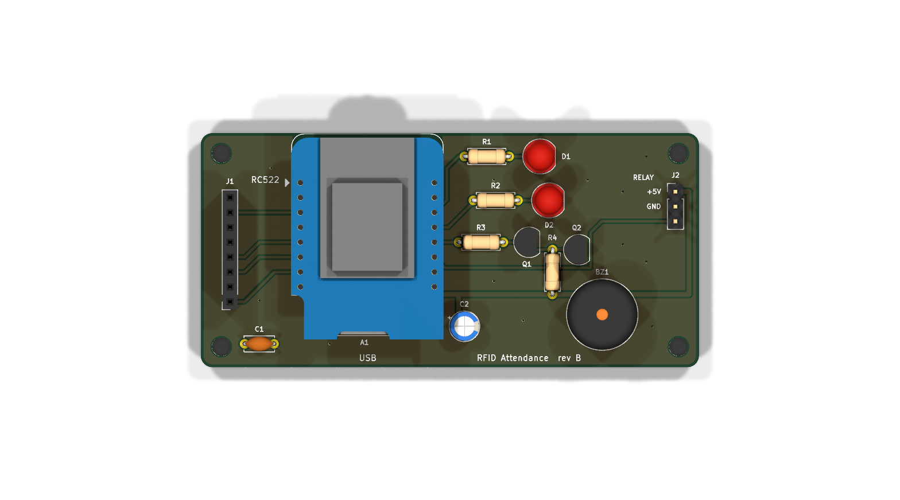
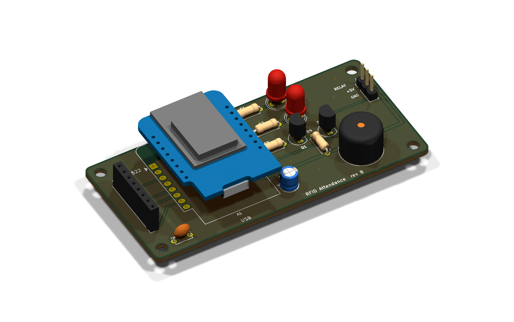
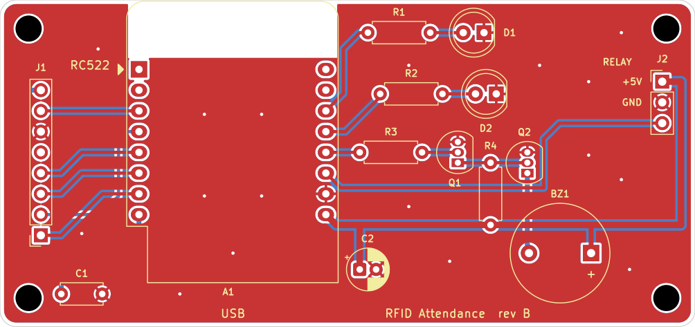
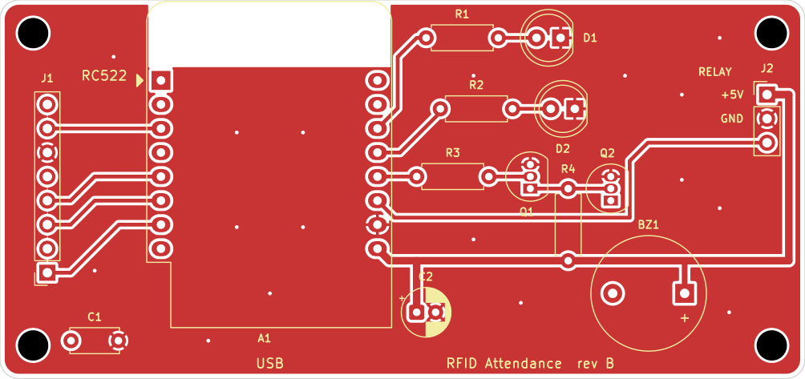
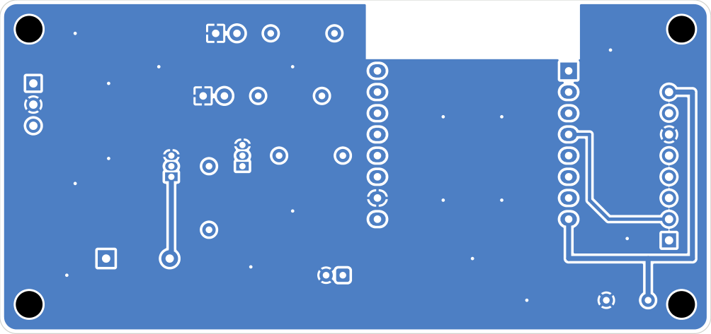
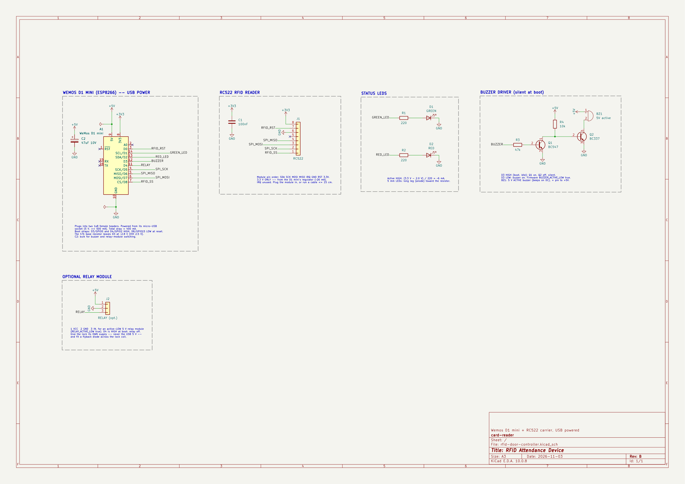

[English](README.md) | **فارسی**

<div dir="rtl">

# سامانهٔ حضور و غیاب و کنترل تردد با RFID (Wemos D1 mini یا ESP32 + RC522)

یک کارت‌خوان که افراد را با کارت RFID شناسایی می‌کند و نتیجه را با LED و بازر اعلام می‌کند: برای کارت مجاز، چراغ سبز و بوق کوتاه؛ برای کارت ناشناس یا مسدود، چراغ قرمز و هشدار. همهٔ ورودها و خروج‌ها با تاریخ و ساعت ثبت می‌شوند. یک خروجی رلهٔ اختیاری هم برای راه‌اندازی قفل برقی وجود دارد.

📖 **راهنمای مونتاژ:** [فارسی](docs/assembly-fa.md) · [English](docs/assembly-en.md)
📄 **پروپوزال پروژه:** [docs/proposal-fa.md](docs/proposal-fa.md)

```
            ┌───────────── حالت سرور ──────────────┐
کارت ─► RC522 ─► Wemos D1 mini ──Wi-Fi──► سرور (Raspberry Pi، Flask + SQLite)
                   │  LED، بازر                 پنل وب: کارت‌ها، دستگاه‌ها، گزارش،
                   │  (رله ← قفل، اختیاری)       حضور و غیاب، افراد داخل، نمایشگر زنده
                   └─ حالت مستقل: کارت‌ها، گزارش و پنل روی خود Wemos
```

| | **حالت سرور** | **حالت مستقل** |
|---|---|---|
| تصمیم‌گیرنده | سرور | Wemos |
| لیست کارت‌ها و گزارش | SQLite روی سرور | حافظهٔ فلش Wemos (تا ۲۰۰ کارت و حدود ۲۰۰۰ رکورد) |
| پنل مدیریت | سرور: `http://<pi>:8080` | دستگاه: `http://<device-name>.local` یا IP آن |
| چند دستگاه | بله، با لیست کارت مشترک | هر دستگاه مستقل است |
| قطع سرور؟ | با لیست کارت ذخیره‌شده کار می‌کند و رویدادها بعداً ارسال می‌شوند | — |
| نیاز به مودم | بله | خیر، دستگاه می‌تواند Wi-Fi خودش را بسازد |

حالت کاری در پنل خود دستگاه عوض می‌شود (تنظیمات ← حالت). دستگاه به نمایشگر نیاز ندارد.

## ساختار مخزن

| پوشه | محتوا |
|---|---|
| `firmware/` | نرم‌افزار Wemos (C++، PlatformIO) |
| `server/` | سرور و پنل وب (Python، Flask، SQLite) |
| `hardware/` | بُرد مدار چاپی حامل (KiCad 10): شماتیک، طرح دولایه، Gerber و تصاویر |
| `docs/` | راهنمای مونتاژ (فارسی/انگلیسی) و پروپوزال |
| `cloudflare/` | اختیاری: همین سرور روی Cloudflare Workers ([راهنمای آن](cloudflare/README.md)) |
| `android/` | اختیاری: برنامهٔ اندروید که گوشی دارای NFC را به دستگاه در (فقط آنلاین) با نمایشگر کیوسک تبدیل می‌کند ([راهنمای آن](android/README.md)) |

---

## ۱. سخت‌افزار

دستگاه **از USB** تغذیه می‌شود (۵ ولت از طریق پورت Micro-USB بُرد Wemos). رگولاتور Wemos ولتاژ ۳٫۳ ولت را برای RC522 می‌سازد. مراحل کامل در [راهنمای مونتاژ](docs/assembly-fa.md) آمده است.

| قطعه | توضیح |
|---|---|
| Wemos D1 mini (ESP8266) | |
| ماژول RC522 + کارت/تگ ۱۳٫۵۶ مگاهرتز | **فقط ۳٫۳ ولت** |
| LED سبز + LED قرمز + دو مقاومت ۲۲۰ اهم | یا ماژول LED |
| بازر | ماژول بازر «تحریک با سطح پایین» (Low-level trigger)، یا بازر فعال ۵ ولت با مدار دو ترانزیستوری راهنمای مونتاژ |
| کابل USB (دیتادار) + آداپتور ۵ ولت | حداقل ۵۰۰ میلی‌آمپر |
| *اختیاری:* ماژول رله + قفل برقی | تغذیهٔ جداگانه برای قفل لازم است؛ [توضیح رله](#رله-و-قفل-اختیاری) را ببینید |

### بُرد مدار چاپی (اختیاری)

طرح KiCad در پوشهٔ [`hardware/`](hardware/README.md) است: بُرد دولایه، ۸۵ × ۴۰ میلی‌متر و تمام قطعات
از نوع پایه‌دار (THT). Wemos D1 mini و RC522 روی سوکت قرار می‌گیرند و LEDها، مدار راه‌انداز بازر
(گزینهٔ ب راهنمای مونتاژ) و یک هدر سه‌پین برای ماژول رلهٔ اختیاری روی خود بُرد هستند.
فایل‌های ساخت (Gerber): [`hardware/fab/rfid-door-controller-gerbers.zip`](hardware/fab/rfid-door-controller-gerbers.zip).

| نمای سه‌بعدی از بالا | نمای سه‌بعدی |
|---|---|
|  |  |

مسیرکشی (قرمز = مس رو، آبی = مس پشت؛ هر دو لایه با سطح زمین پر شده‌اند):



| مس لایهٔ رو | مس لایهٔ پشت (از زیر) |
|---|---|
|  |  |

شماتیک ([PDF](hardware/rfid-door-controller-schematic.pdf)):



### سیم‌کشی

| RC522 | Wemos | | ماژول | Wemos |
|---|---|---|---|---|
| SDA (SS) | D8 | | LED سبز | D1 |
| SCK | D5 | | LED قرمز | D2 |
| MOSI | D7 | | بازر | D3 |
| MISO | D6 | | *(اختیاری)* ورودی رله | D4 |
| RST | D0 | | | |
| 3.3V | 3V3 | | | |
| GND | G | | | |
| IRQ | — | | | |

پایه‌های D5، D6 و D7 همان SPI سخت‌افزاری ESP8266 هستند و قابل تغییر نیستند. پایه‌های D3 و D4 هنگام روشن شدن باید HIGH و D8 باید LOW باشد. به همین دلیل بازرِ روی D3 باید **وقتی ورودی‌اش HIGH است ساکت باشد**: از ماژول Low-level trigger یا مدار ترانزیستوری استفاده کنید و در `firmware/src/config.h` مقدار `BUZZER_ACTIVE_LOW` را `true` بگذارید. D4 همان LED روی بُرد Wemos هم هست، پس این LED در زمان دسترسی مجاز روشن می‌شود.

پایه‌ها و قطبیت (Active-high/low) در `firmware/src/config.h` تنظیم می‌شوند.

### سیم‌کشی بُرد ESP32 DevKit

همین نرم‌افزار روی بُرد ESP32 DevKit (ESP-WROOM-32) هم اجرا می‌شود. RC522 به پایه‌های SPI پیش‌فرض ESP32 وصل می‌شود:

| RC522 | ESP32 | | ماژول | ESP32 |
|---|---|---|---|---|
| SDA (SS) | G5 | | LED سبز | G25 |
| SCK | G18 | | LED قرمز | G26 |
| MOSI | G23 | | بازر | G27 |
| MISO | G19 | | *(اختیاری)* ورودی رله | G32 |
| RST | G0 | | | |
| 3.3V | 3V3 | | | |
| GND | GND | | | |
| IRQ | — | | | |

پایه‌های G25، G26، G27 و G32 در ESP32 محدودیت زمان روشن شدن ندارند، پس هر نوع بازری قابل استفاده است. مقدار `BUZZER_ACTIVE_LOW` را مطابق بازر خود تنظیم کنید. G0 همان دکمهٔ **BOOT** روی بُرد است، پس نگه داشتن BOOT کارت‌خوان را ریست می‌کند. برای جابه‌جا کردن RST مقدار `PIN_RC522_RST` را در `config.h` تغییر دهید (G4 یا G22 گزینه‌های خوبی هستند). بُرد مدار چاپی پوشهٔ `hardware/` فقط برای D1 mini است. بُرد ESP32 را از درگاه USB تغذیه کنید؛ پایهٔ 3V3 آن RC522 را تغذیه می‌کند.

### علائم دستگاه

| آنچه دیده یا شنیده می‌شود | معنی |
|---|---|
| بوق کوتاه + سبز | دسترسی مجاز (ورود/خروج ثبت شد) |
| سه بار قرمز + بوق | کارت مسدود یا منقضی |
| یک قرمز طولانی + بوق | کارت ناشناس |
| سبز و قرمز به‌تناوب | منتظر کارت برای ثبت (حالت مستقل) |
| چشمک کوتاه قرمز هر ۳ ثانیه | حالت سرور: سرور در دسترس نیست (کار با لیست ذخیره‌شده) |
| چشمک آهستهٔ قرمز | Wi-Fi راه‌اندازی دستگاه فعال است (به مودم وصل نیست) |
| سه بار قرمز بدون بوق هنگام روشن شدن | RC522 پیدا نشد: سیم‌کشی را بررسی کنید |

---

## ۲. نرم‌افزار دستگاه (Firmware)

[PlatformIO](https://platformio.org/) را نصب کنید (افزونهٔ VS Code یا `pip install platformio`)، سپس:

</div>

```bash
cd firmware
pio run -t upload                 # Wemos D1 mini: کامپایل و آپلود
pio run -e esp32dev -t upload     # ESP32 DevKit: کامپایل و آپلود
pio device monitor                # لاگ سریال، 115200 baud
```

<div dir="rtl">

دستور `pio run -t uploadfs` را اجرا نکنید: تنظیمات و کارت‌های ذخیره‌شده را پاک می‌کند.

### اولین راه‌اندازی

1. دستگاه در اولین روشن شدن یک Wi-Fi با نام **`RFID-Setup-xxxxxx`** و رمز **`rfid12345`** می‌سازد.
2. به آن وصل شوید و **http://192.168.4.1** را باز کنید. با **admin / admin** وارد شوید.
3. در **تنظیمات**، حالت کاری را انتخاب کنید، تنظیمات Wi-Fi و سرور را وارد کنید، **رمز مدیر را عوض کنید** و «ذخیره و راه‌اندازی مجدد» را بزنید.

اگر هنگام روشن شدن مودم در دسترس نباشد، Wi-Fi راه‌اندازی دوباره باز می‌شود. دستگاه در این مدت کار می‌کند و با در دسترس آمدن مودم، Wi-Fi راه‌اندازی بسته می‌شود.

### حالت مستقل (تیم‌های کوچک)

- **افزودن کارت:** در زبانهٔ کارت‌ها نام را بنویسید، دکمهٔ «ثبت با کارت‌زدن» را بزنید و کارت را روی دستگاه بگیرید. یا اول یک کارت ناشناس را اسکن کنید؛ زبانهٔ وضعیت گزینهٔ «ثبت این کارت» را نشان می‌دهد.
- **مسدود، مجاز یا حذف** کارت‌ها از همان لیست.
- **زبانهٔ گزارش:** ۱۰۰ رویداد آخر را نشان می‌دهد. «خروجی اکسل (CSV)» کل گزارش را با منطقهٔ زمانی مرورگر شما خروجی می‌گیرد.
- **بدون مودم:** گزینهٔ «بدون روتر — دستگاه وای‌فای خودش را می‌سازد» را تیک بزنید. دستگاه Wi-Fi با نام دستگاه و رمز شما در http://192.168.4.1 می‌سازد. ساعت دستگاه هر بار که پنل را باز کنید از گوشی یا کامپیوتر تنظیم می‌شود. با مودم، از NTP استفاده می‌کند.
- **جهت:** حالت `toggle` اسکن‌ها را به‌ترتیب ورود ← خروج ← ورود ثبت می‌کند. برای دستگاهی که فقط ورود یا فقط خروج است، `in` یا `out` را انتخاب کنید.

### حالت سرور

1. در پنل سرور به **درها ← افزودن** بروید و **کلید دستگاه** را کپی کنید (فقط یک بار نمایش داده می‌شود).
2. در پنل دستگاه، حالت را «سرور» بگذارید و **آدرس سرور** (مثلاً `http://192.168.1.10:8080`) و **کلید دستگاه** را وارد کنید.
3. یک کارت جدید اسکن کنید. در داشبورد سرور زیر **کارت‌های ثبت‌نشده** ظاهر می‌شود و با **ثبت کارت** اضافه می‌شود.

دستگاه هر ۵ ثانیه با سرور همگام می‌شود: با تغییر لیست کارت‌ها آن را دانلود می‌کند، دستور «باز کن» پنل را می‌گیرد، ساعتش را از سرور تنظیم می‌کند و رویدادهای زمان قطعی را ارسال می‌کند (در گزارش با برچسب *آفلاین*). اگر می‌خواهید در زمان قطع سرور همهٔ کارت‌ها رد شوند، تیک «اگر سرور در دسترس نبود، از فهرست ذخیره‌شده کارت‌ها استفاده شود» را بردارید.

---

## ۳. سرور (Raspberry Pi یا هر سیستم لینوکسی)

</div>

```bash
sudo mkdir -p /opt/accessctl && sudo chown $USER /opt/accessctl
cp -r server /opt/accessctl/
python3 -m venv /opt/accessctl/venv
/opt/accessctl/venv/bin/pip install -r /opt/accessctl/server/requirements.txt

# اجرای آزمایشی
cd /opt/accessctl/server && ACCESSCTL_DATA=/opt/accessctl/data ../venv/bin/python app.py
```

<div dir="rtl">

اولین اجرا **رمز مدیر** ساخته‌شده را چاپ می‌کند. `http://<pi-ip>:8080` را باز کنید.

برای اجرا به‌صورت سرویس (در کنار سرویس‌های دیگر Pi)، مقدار `User=` را در `server/accessctl.service` تنظیم کنید، سپس:

</div>

```bash
sudo cp server/accessctl.service /etc/systemd/system/
sudo systemctl daemon-reload && sudo systemctl enable --now accessctl
journalctl -u accessctl -f
```

<div dir="rtl">

سرور یک پروسه است (waitress با ۸ Thread) با یک فایل SQLite در پوشهٔ `ACCESSCTL_DATA`. از فایل‌های `access.db` و `secret_key` آن پوشه نسخهٔ پشتیبان بگیرید. برای بازنشانی رمز: `../venv/bin/python app.py set-password admin`.

### سازمان‌ها و کاربران

یک سرور می‌تواند چند **سازمان** (شرکت یا تیم) مستقل از هم را میزبانی کند. هر سازمان کاربران پنل، کارت‌ها، دستگاه‌ها، گزارش‌ها و کلاس‌های خودش را دارد و هرگز داده‌های سازمان دیگر را نمی‌بیند.

- **مدیر سرور** (`admin` و هر مدیری که اضافه کنید): وارد **مدیریت سرور** (`/admin`) می‌شود. آنجا سازمان را همراه با اولین نام کاربری‌اش می‌سازد، کاربران آن را اضافه یا حذف می‌کند، رمز را عوض می‌کند، سازمان را غیرفعال می‌کند (کاربرانش وارد نمی‌شوند و دستگاه‌هایش همه کارت‌ها را رد می‌کنند) یا آن را با همهٔ داده‌هایش حذف می‌کند. دکمهٔ **ورود به پنل** پنل هر سازمان را باز می‌کند.
- **کاربران سازمان** فقط پنل خودشان را می‌بینند. **دستگاه‌های** خودشان را تعریف می‌کنند (هر دستگاه یک کلید برای Wemos یا برنامهٔ اندروید می‌گیرد)، کارت ثبت می‌کنند، کلاس می‌سازند و از بخش تنظیمات کاربران دیگری برای سازمان خود اضافه می‌کنند.
- یک کارت (UID) می‌تواند در دو سازمان ثبت شود. کلید دستگاه‌ها در کل سرور یکتاست، پس هر کارت‌زدن به سازمانِ صاحب همان دستگاه تعلق دارد.

به‌روزرسانی از نسخهٔ تک‌سازمانی خودکار است: در اولین اجرا کارت‌ها، درها و گزارش‌های موجود به سازمانی به نام «سازمان پیش‌فرض» منتقل می‌شوند و کاربران قبلی مدیر سرور می‌شوند. نام آن را در صفحهٔ مدیریت تغییر دهید.

### کلاس‌ها (حضور و غیاب هر کلاس)

در صفحهٔ **کلاس‌ها** هر سازمان کلاس می‌سازد، **اعضا** را از بین کارت‌هایش انتخاب می‌کند و کلاس را **در زمان‌های مشخص به یک دستگاه** وصل می‌کند:

- **هفتگی**: یک یا چند روز هفته و بازهٔ ساعت، در صورت تمایل بین دو تاریخ (بدون تاریخ شروع، از روز افزودن شروع می‌شود)، یا
- **یک‌بار**: جلسهٔ فوق‌العاده در یک تاریخ.

در زمان جلسه، اعضا هنگام **ورود** و دوباره هنگام **خروج** کارت می‌زنند (دستگاه در هر جلسه به‌ترتیب ورود و خروج ثبت می‌کند؛ دستگاهی که «فقط ورود» یا «فقط خروج» است همان جهت را ثبت می‌کند). کارت افرادی که عضو کلاس نیستند **رد می‌شود** و با عنوان «عضو کلاس نیست» ثبت می‌شود. کارت‌زدن از ۱۵ دقیقه قبل از شروع تا ۳۰ دقیقه بعد از پایان پذیرفته می‌شود، ولی فقط زمان داخل ساعت کلاس حساب می‌شود. ورودِ بدون خروج تا پایان کلاس حساب و با «خروج ثبت نشد» مشخص می‌شود. خارج از زمان کلاس‌ها دستگاه مثل یک در معمولی کار می‌کند.

صفحهٔ هر کلاس برای یک بازهٔ تاریخ (پیش‌فرض ۳۰ روز اخیر) نشان می‌دهد:
- همهٔ **جلسات** و تعداد حاضران، و در هر جلسه برای هر عضو **ساعت ورود، ساعت خروج و مدت حضور در کلاس** (غایبان با «غایب» مشخص می‌شوند) و کارت‌های ردشده؛
- **خلاصهٔ هر عضو**: تعداد جلسات حاضر، مجموع زمان حضور و درصد حضور، با خروجی CSV.

داشبورد کلاس‌های در حال برگزاری و تعداد اعضای داخل کلاس را نشان می‌دهد.

### پنل

هر دو پنل (سرور و دستگاه) **فارسی و راست‌به‌چپ** هستند. تاریخ‌ها با **تقویم شمسی** و ارقام فارسی نمایش داده می‌شوند. فیلدهای تاریخ، تاریخ شمسی مثل `1405/08/11` می‌پذیرند (ارقام فارسی هم قبول است). خروجی CSV تاریخ شمسی و میلادی دارد و با BOM شروع می‌شود تا اکسل نام‌های فارسی را درست نشان دهد. فونت وزیرمتن داخل سرور است و به اینترنت نیاز ندارد.

- **نمایشگر زنده** (صفحهٔ اول، `/`): نمایش تمام‌صفحه برای تبلت یا مانیتور کنار در. نام فرد را با ✓ سبز «خوش آمدید / خدانگهدار» یا ✗ قرمز «دسترسی رد شد» همراه با دلیل نشان می‌دهد و برای هر اسکن صدا پخش می‌کند (Web Audio، بدون فایل صوتی). ساعت، تاریخ شمسی و ۱۰ تردد اخیر را هم نشان می‌دهد. یک بار روی صفحه بزنید تا مرورگر اجازهٔ صدا بدهد. **درها ← نمایشگر** برای هر دستگاه یک لینک اختصاصی می‌دهد که **بدون ورود** کار می‌کند. هر کس لینک را داشته باشد ترددهای آن دستگاه را می‌بیند و با **کلید جدید** باطل می‌شود.
- **داشبورد** (`/dashboard`): افراد داخل، آمار امروز، وضعیت آنلاین دستگاه‌ها، کارت‌های ثبت‌نشده، آخرین ترددها.
- **کارت‌ها**: افزودن، ویرایش، مسدود یا مجاز کردن؛ تاریخ اعتبار و توضیحات اختیاری؛ سوابق هر کارت.
- **دستگاه‌ها**: جهت (ورود، خروج یا متناوب)، فعال/غیرفعال، کلید جدید، لینک نمایشگر.
- **کلاس‌ها**: اعضا، زمان‌بندی هفتگی یا یک‌باره روی یک دستگاه، گزارش حضور هر جلسه و هر عضو.
- **گزارش تردد**: فیلتر بر اساس نام، شناسه، نتیجه، دستگاه، کلاس و تاریخ؛ خروجی CSV.
- **حضور روزانه**: اولین ورود، آخرین خروج و مدت حضور هر نفر در هر روز.
- **تنظیمات**: کاربران پنل سازمان، حذف رویدادهای قدیمی سازمان.
- **مدیریت سرور** (فقط مدیر سرور): سازمان‌ها، کاربرانشان و اتصال به سرویس‌های دیگر.

### اتصال به سرویس‌های دیگر

- `ACCESSCTL_WEBHOOK_URL=http://…`: هر رویداد به‌صورت JSON به این آدرس POST می‌شود. با Node-RED، Home Assistant، ربات تلگرام و … کار می‌کند.
- `ACCESSCTL_API_TOKEN=…`: مسیرهای `GET /api/v1/presence` و `GET /api/v1/events?since=<id>` را با هدر `Authorization: Bearer <token>` فعال می‌کند. این توکن مخصوص مدیر سرور است و همهٔ سازمان‌ها را می‌خواند؛ با `&org=<id>` به یک سازمان محدود می‌شود.

### پروتکل دستگاه و سرور

همهٔ درخواست‌ها هدر `X-Device-Key: <key>` دارند.

| درخواست | بدنه | پاسخ |
|---|---|---|
| `POST /api/v1/scan` | `{"uid":"04:A3:1B:2C"}` | `{"granted":true,"result":"granted","name":"سارا","direction":"in","open_ms":3000}` |
| `POST /api/v1/sync` | `{"fw":"1.0.0","cards_version":"…","events":[…]}` | `{"time":…,"cards_version":"…","open":false,"open_ms":3000}` |
| `GET /api/v1/cards` | — | سطرهای TSV: `uid⇥1⇥inside⇥name` (فقط کارت‌های معتبر) |
| `GET /api/v1/kiosk` | — | `{"name":"…","url":"/kiosk/<token>"}` — لینک نمایشگر همین در (برای برنامهٔ اندروید) |

مقدار `result` یکی از `granted | unknown | disabled | expired | denied` است (denied یعنی دستگاه غیرفعال است).

---

## رله و قفل (اختیاری)

Firmware در هر دسترسی مجاز و با دکمهٔ «باز کن» پنل، رلهٔ روی **D4** را به مدت `open_ms` میلی‌ثانیه (پیش‌فرض ۳ ثانیه) فعال می‌کند. برای استفاده، یک ماژول رلهٔ Active-LOW (`RELAY_ACTIVE_LOW true`) به D4 وصل کنید و برای قفل **منبع تغذیهٔ جداگانه** بگذارید. قفل را از ۵ ولت USB بُرد Wemos تغذیه نکنید. یک دیود هرزگرد روی سیم‌پیچ قفل بگذارید و در داخل، یک دکمهٔ خروج یا بازکنندهٔ مکانیکی نصب کنید.

---

## نکات امنیتی

- کارت‌های ساده ۱۳٫۵۶ مگاهرتز (MIFARE Classic و تگ‌های ارزان) **قابل کپی هستند**. سامانه فقط UID را بررسی می‌کند، پس برای حضور و غیاب در دفتر، آزمایشگاه و کلاس مناسب است، نه برای درهای با امنیت بالا.
- پنل دستگاه با HTTP Basic Auth کار می‌کند و ارتباط دستگاه با سرور Flask روی HTTP ساده است. هر دو را در شبکهٔ محلی مطمئن نگه دارید و روی اینترنت باز نکنید.
- رمز `admin/admin` و رمز Wi-Fi راه‌اندازی را در اولین راه‌اندازی عوض کنید.

</div>
