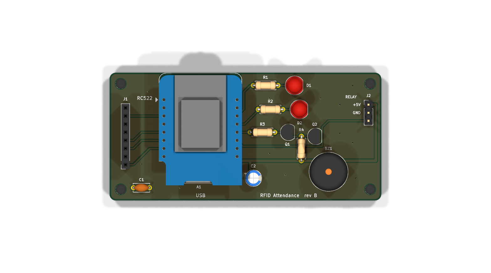
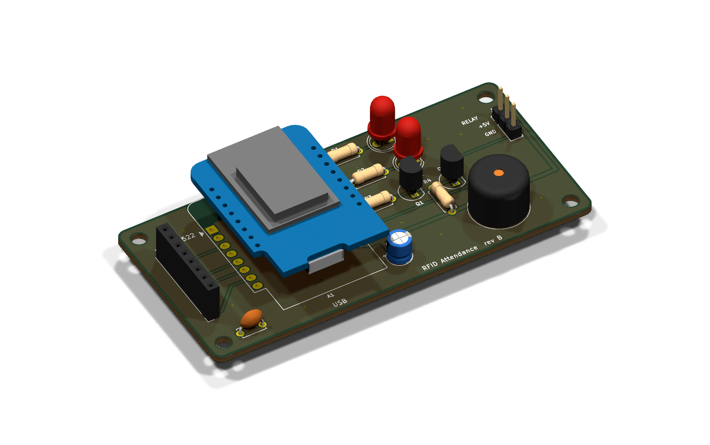
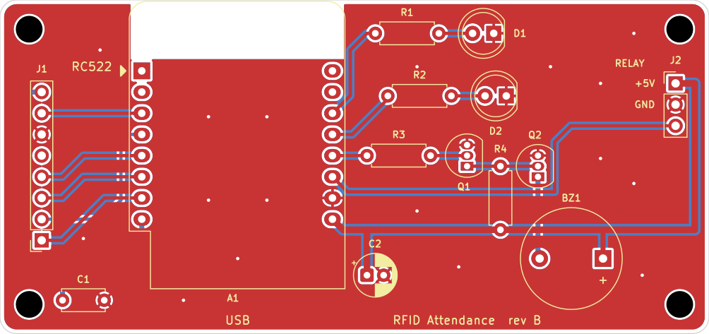
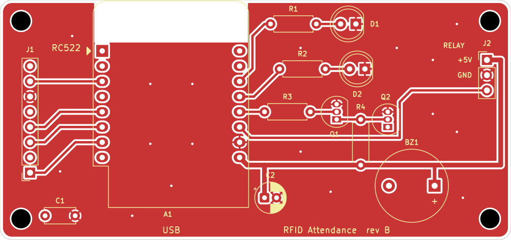
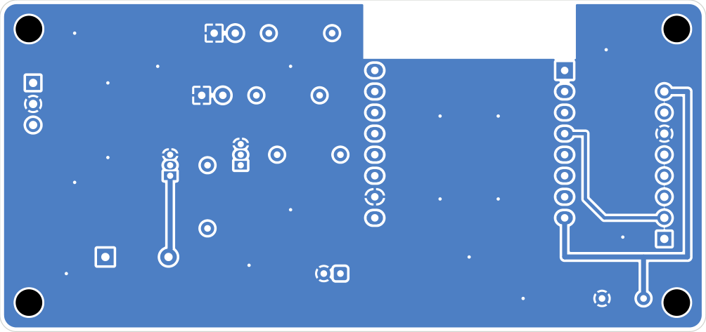
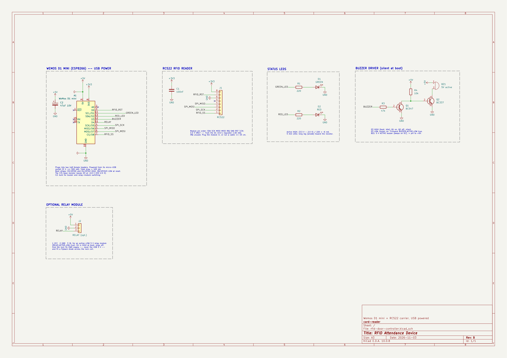

**English** | [فارسی](README.fa.md)

# RFID attendance & access control (Wemos D1 mini + RC522)

A card reader that identifies people by RFID card and shows the result with LEDs
and a buzzer: green and a short beep for allowed cards, red and an alarm for unknown
or blocked cards. It logs every entry and exit with date and time. An optional relay
output can drive an electric lock.

📖 **Assembly guide:** [English](docs/assembly-en.md) · [فارسی](docs/assembly-fa.md)
📄 **Project proposal (Persian):** [docs/proposal-fa.md](docs/proposal-fa.md)

```
            ┌───────────── server mode ──────────────┐
 card ─► RC522 ─► Wemos D1 mini ──Wi-Fi──► server (Raspberry Pi, Flask + SQLite)
                   │  LEDs, buzzer              web panel: cards, devices, log,
                   │  (optional relay → lock)   attendance, who's inside, live screen
                   └─ standalone mode: cards + log + panel on the Wemos itself
```

| | **Server mode** | **Standalone mode** |
|---|---|---|
| Who decides | the server | the Wemos |
| Card list / log | SQLite on the server | flash on the Wemos (≤200 cards, ~2000 log lines) |
| Admin panel | server: `http://<pi>:8080` | device: `http://<device-name>.local` or its IP |
| Multiple devices | yes, shared card list | each device is independent |
| Server down? | keeps working from a cached card list; events are uploaded later | n/a |
| Needs a router | yes | no: the device can create its own Wi-Fi |

You switch modes in the device's own panel (Settings → Mode). No display is needed on the device.

## Repository layout

| Folder | Contents |
|---|---|
| `firmware/` | Wemos firmware (C++, PlatformIO) |
| `server/` | Server and web panel (Python, Flask, SQLite) |
| `hardware/` | Carrier PCB (KiCad 10): schematic, 2-layer layout, gerbers, renders |
| `docs/` | Assembly guide (EN/FA) and project proposal |
| `cloudflare/` | Optional: the same server on Cloudflare Workers ([its README](cloudflare/README.md)) |
| `android/` | Optional: Android app that turns an NFC phone into an online-only door device with a kiosk screen ([its README](android/README.md)) |

---

## 1. Hardware

The device is powered **from USB** (5 V into the Wemos's micro-USB port). The Wemos's
regulator makes 3.3 V for the RC522. Full step-by-step instructions are in the
[assembly guide](docs/assembly-en.md).

| Part | Notes |
|---|---|
| Wemos D1 mini (ESP8266) | |
| RC522 RFID module + 13.56 MHz cards/tags | **3.3 V only** |
| Green LED + red LED + 2 × 220 Ω resistors | or an LED module |
| Buzzer | a low-level-trigger buzzer module, or a 5 V active buzzer with the 2-transistor driver from the assembly guide |
| USB cable (data-capable) + 5 V USB adapter | ≥ 500 mA |
| *Optional:* relay module + electric lock | needs its own lock supply; see the [relay note](#optional-relay-and-lock) |

### Carrier PCB (optional)

The KiCad design is in [`hardware/`](hardware/README.md): a 2-layer, 85 × 40 mm, all through-hole
board. The D1 mini and the RC522 plug into sockets, and the board carries the LEDs, the buzzer driver
(option B in the assembly guide) and a 3-pin header for an optional relay module. Gerbers:
[`hardware/fab/rfid-door-controller-gerbers.zip`](hardware/fab/rfid-door-controller-gerbers.zip).

| 3D, top | 3D |
|---|---|
|  |  |

Routing (red = top copper, blue = bottom copper, both with a ground pour):



| Top copper | Bottom copper (seen from below) |
|---|---|
|  |  |

Schematic ([PDF](hardware/rfid-door-controller-schematic.pdf)):



### Wiring

| RC522 | Wemos | | Module | Wemos |
|---|---|---|---|---|
| SDA (SS) | D8 | | Green LED | D1 |
| SCK | D5 | | Red LED | D2 |
| MOSI | D7 | | Buzzer | D3 |
| MISO | D6 | | *(optional)* Relay IN | D4 |
| RST | D0 | | | |
| 3.3V | 3V3 | | | |
| GND | G | | | |
| IRQ | — | | | |

SCK/MISO/MOSI (D5/D6/D7) are the ESP8266's hardware SPI pins and can't be moved.
D3/D4 must be HIGH and D8 LOW at boot. That is why the buzzer on D3 must be **silent when
its input is HIGH**: use a low-level-trigger module or the transistor driver, and set
`BUZZER_ACTIVE_LOW true` in `firmware/src/config.h`. D4 is also the Wemos's on-board
LED, so that LED lights while access is granted.

Pins and active-high/low polarity are set in `firmware/src/config.h`.

### Signals

| What you see/hear | Meaning |
|---|---|
| short beep + green | access granted (entry/exit logged) |
| 3 × red + beep | blocked / expired card |
| 1 long red + beep | unknown card |
| green/red alternating | waiting for a card to enroll (standalone) |
| short red flash every 3 s | server mode: server unreachable (using offline cache) |
| slow red blink | setup Wi-Fi hotspot is open (not connected to the router) |
| 3 × red, no beep at boot | RC522 not detected: check wiring |

---

## 2. Firmware

Install [PlatformIO](https://platformio.org/) (VS Code extension or `pip install platformio`), then:

```bash
cd firmware
pio run -t upload        # build + flash
pio device monitor       # serial log, 115200 baud
```

Don't run `pio run -t uploadfs`: it erases the saved settings and cards.

### First start

1. On first boot the device opens a Wi-Fi hotspot **`RFID-Setup-xxxxxx`**, password **`rfid12345`**.
2. Connect to it and open **http://192.168.4.1**. Log in as **admin / admin**.
3. In **Settings**, choose a mode, fill in the Wi-Fi and server settings, **change the admin password**, then press *Save & reboot*.

If the router is unreachable at boot, the setup hotspot opens again. The device keeps
working meanwhile, and the hotspot closes once the router is reachable.

### Standalone (small teams)

- **Add cards:** on the Cards tab, type a name, press **Scan to add**, then hold the card on the reader.
  Or scan an unknown card first: the Status tab then offers **Add this card**.
- **Block, allow or delete** cards from the same list.
- **Log tab:** shows the latest 100 events. **Download CSV** exports the whole log in your browser's timezone.
- **No router:** tick *"No router — this device creates its own Wi-Fi"*. The device then runs
  hotspot `<device name>` with your password at http://192.168.4.1. The clock is set from your
  phone or PC whenever you open the panel. With a router, it uses NTP instead.
- **Direction:** `toggle` makes scans alternate in → out → in. Use `in` or `out` for a reader that only handles one side.

### Server mode

1. In the server panel, go to **Doors → Add**. Copy the **device key** shown (it is shown only once).
2. In the device panel, set Mode = Server, enter the **Server URL** (e.g. `http://192.168.1.10:8080`) and the **Device key**.
3. Scan a new card. It appears on the server dashboard under **Unregistered cards**, where you click **Register**.

The device sends a heartbeat every 5 s. Through it, the device downloads the card list whenever it
changes, picks up "Open" commands from the panel, takes its clock from the server, and uploads
events it decided while offline (marked *offline* in the log). To refuse all cards while the
server is down, untick *"use the cached card list"*.

---

## 3. Server (Raspberry Pi or any Linux box)

```bash
sudo mkdir -p /opt/accessctl && sudo chown $USER /opt/accessctl
cp -r server /opt/accessctl/
python3 -m venv /opt/accessctl/venv
/opt/accessctl/venv/bin/pip install -r /opt/accessctl/server/requirements.txt

# try it
cd /opt/accessctl/server && ACCESSCTL_DATA=/opt/accessctl/data ../venv/bin/python app.py
```

The first start prints the generated password for **admin**, the server owner. Open `http://<pi-ip>:8080`.

To run it as a service, next to whatever else the Pi is doing, edit `User=` in
`server/accessctl.service`, then:

```bash
sudo cp server/accessctl.service /etc/systemd/system/
sudo systemctl daemon-reload && sudo systemctl enable --now accessctl
journalctl -u accessctl -f
```

It's a single process (waitress, 8 threads) with one SQLite file in `ACCESSCTL_DATA`.
Back up `access.db` and `secret_key` from that folder.
To reset a password: `../venv/bin/python app.py set-password admin` (an unknown name creates a new server owner).

### Companies and users

One server can host several **companies** (or teams) that have nothing to do with each other.
Each company has its own panel users, cards, devices, logs and classes, and never sees another company's data.

- **Server owner** (`admin`, and any owner you add): logs in to **مدیریت سرور** (`/admin`). There you create a company
  together with its first login, add or remove its users, reset passwords, disable it (its users can't log in and its
  devices refuse every card) or delete it with all its data. **ورود به پنل** opens any company's panel.
- **Company users** see only their own panel. They create their own **devices** (each gets a key for the Wemos or the
  Android app), register cards, define classes and add more users for their company under Settings.
- The same card UID can be registered in two companies. Device keys are unique across the server, so a scan always
  belongs to the company that owns the device.

Upgrading from the single-company version is automatic: on first start the existing cards, doors and logs move into a
company called «سازمان پیش‌فرض», and the existing logins become server owners. Rename it on the admin page.

### Quick card registration

**ثبت سریع کارت** (also linked from the Cards page): put one device in **card-registration mode** and keep the page
open. Every card placed on that device pops up on the page with "این کارت به چه نامی ثبت شود؟"; type the name, press
Enter, and put the next card on. Cards scanned quickly one after another wait in a queue. A card that is already
registered shows its current name and can be renamed. New cards can be added to a class in the same step.
While a device is in registration mode it opens nothing, and the Wemos plays its "enrolled" beep (firmware 1.0.2).
Turn the mode off on the same page or on Devices.

### Plans, subscriptions and support tickets

The server owner sells plans on **پلن‌ها** (`/admin/plans`): a name, a billing period (**daily, weekly, monthly or
yearly**), a price per period and limits on **panel users, devices, cards and classes** (empty = unlimited). Plans
marked as public appear on each company's **اشتراک** page.

- A company clicks **درخواست این پلن**, or fills in a **custom plan** (how many users, devices, cards and classes, and
  the period). Either one opens a **ticket** for the owner. Companies can also open plain tickets.
- The owner sees new tickets under **تیکت‌ها** (with a counter). The ticket page has the subscription form already
  filled in from the request; the owner changes whatever is needed (price, limits, period, end date) and applies it,
  which also answers and closes the ticket. Any company's subscription can be edited on its page (`/admin/orgs/<id>`).
- **Payments** are recorded by hand on the company's page: the number of periods paid extends the subscription
  (1, 7, 30 or 365 days per period) from its current end date, or from today if it has already ended.
- **Limits** are enforced when a company adds users, devices, cards (including quick registration) or classes;
  the server owner, working inside a company's panel, is not limited. Lowering a limit never deletes anything.
- When the subscription end date has passed, the company's panel shows a red notice. Nothing is switched off
  automatically: devices keep working until the owner disables the company.

Prices are shown in تومان; set `ACCESSCTL_CURRENCY` (Flask) or the `CURRENCY` variable (Cloudflare) to change the label.
Companies that existed before this version have no plan and no limits until the owner sets them.

### Classes (attendance per class)

On the **کلاس‌ها** page a company creates classes, picks the **members** (from its cards) and links the class to a
**device at set times**:

- **weekly**: one or more weekdays and a time range, optionally between two dates (without a start date it starts on
  the day you add it), or
- **once**: an extra session on a single date.

During a session, members scan their card on that device when they **enter** and again when they **leave**
(the device alternates in/out per session; a device set to entry-only or exit-only records that direction).
Cards of people who are not members are **refused** and logged as «عضو کلاس نیست». Scans are accepted from 15 minutes
before the start until 30 minutes after the end, so early arrivals and late exits are recorded, but only time inside
the class hours counts. An entry with no exit counts until the end of the class and is flagged «خروج ثبت نشد».
Outside class times the device works as a normal door.

Each class page shows, for a date range (last 30 days by default):
- every **session** with how many members came, and per session each member's **entry time, exit time and time in
  class** (absent members are marked «غایب»), plus refused cards;
- a **summary per member**: sessions attended, total time in class and attendance percentage, with CSV export.

The dashboard lists classes that are running now and how many members are inside.

### Panel

Both panels (server and device) are in **Persian, right-to-left**. Dates are shown in the
**Shamsi (Jalali) calendar** with Persian digits. Date fields take Shamsi dates such as
`1405/08/11` (Persian digits work too). CSV exports include Shamsi and Gregorian dates and
start with a UTF-8 BOM, so Excel displays Persian names correctly. The server bundles the
Vazirmatn font (`static/fonts`, SIL OFL), so it doesn't need internet. The device panel uses
the system font (Tahoma/Segoe UI).

- **Live screen** (landing page, `/`): a full-screen display for a tablet or monitor by the door. It shows the
  person's name with a green ✓ «خوش آمدید / خدانگهدار», or a red ✗ «دسترسی رد شد» with the reason (unknown card,
  blocked or expired). Each scan plays a sound through the browser (Web Audio, no audio files needed). It also shows
  a clock in Shamsi date and the last 10 scans. Tap the screen once so the browser allows sound, and use the ⛶ button
  for full screen. **Doors → نمایشگر** gives each device a private link that works **without logging in**.
  Anyone with the link can see that device's scans, and **New key** revokes it.
- **Dashboard** (`/dashboard`): who is inside, today's counts, device online/offline status, unregistered cards, recent activity.
- **Cards**: add, edit, block or allow; optional **valid-until** date and a note; per-card history.
- **Devices**: direction (entry, exit or toggle), enable/disable, card-registration mode, new key, live-screen link.
- **Quick card registration**: name cards as they are scanned on a reader.
- **Classes**: members, weekly or one-off schedules on a device, per-session and per-member attendance reports.
- **Log**: filter by name, UID, result, device, class and date; CSV export.
- **Daily attendance**: first in, last out and time on site per person per day.
- **Subscription** (اشتراک): current plan, usage against limits, payments, available plans, plan requests and tickets.
- **Settings**: the company's panel users, purging the company's old events.
- **Server admin** (owners only): companies, their users and subscriptions, plans, tickets, integrations.

### Hooking it into other things on the server

- `ACCESSCTL_WEBHOOK_URL=http://…`: every event of every company is POSTed as JSON, e.g.
  `{"time": "...", "org": "Acme", "org_id": 2, "door": "Main", "name": "Sara", "uid": "04:A3:1B:2C", "result": "granted", "direction": "in", "class_id": null, "offline": false}`.
  Works with Node-RED, Home Assistant, a Telegram bot, etc.
- `ACCESSCTL_API_TOKEN=…` enables `GET /api/v1/presence` and `GET /api/v1/events?since=<id>`
  (header `Authorization: Bearer <token>`). The token is the server owner's: it reads all companies; add `&org=<id>`
  to limit it to one.

### Device ↔ server protocol

All requests carry the header `X-Device-Key: <key>`.

| Call | Body | Reply |
|---|---|---|
| `POST /api/v1/scan` | `{"uid":"04:A3:1B:2C"}` | `{"granted":true,"result":"granted","name":"Sara","direction":"in","open_ms":3000}` |
| `POST /api/v1/sync` | `{"fw":"1.0.0","cards_version":"…","events":[{ts,uid,result,direction}…]}` | `{"time":…,"cards_version":"…","open":false,"open_ms":3000}` |
| `GET /api/v1/cards` | — | TSV lines `uid⇥1⇥inside⇥name` (valid cards only) |
| `GET /api/v1/kiosk` | — | `{"name":"Front door","url":"/kiosk/<token>"}` — this door's live-screen link (used by the Android app) |

`result` is one of `granted | unknown | disabled | expired | denied | not_member | enroll` (denied = device or company disabled;
not_member = scanned during a class session by someone who isn't a member; enroll = the device is in
card-registration mode, nothing opens).

---

## Optional: relay and lock

The firmware also drives a relay on **D4** for `open_ms` milliseconds (default 3 s) on every
granted scan, and on **Open** from the panel. To use it, connect an active-LOW relay module
(`RELAY_ACTIVE_LOW true`) to D4 and give the lock **its own power supply**. Don't power a
lock from the Wemos's USB 5 V. Put a flyback diode across the lock coil, and keep a
mechanical or exit-button release on the inside of the door.

---

## Security notes

- Basic 13.56 MHz cards (MIFARE Classic, cheap tags) **can be cloned**. Only the UID is checked,
  so this suits attendance in offices, labs and classrooms, not high-security doors.
- The device panel uses HTTP Basic auth, and device ↔ Flask server traffic is plain HTTP. Keep both
  on a trusted LAN or Wi-Fi, and don't port-forward them to the internet.
- Change `admin/admin` and the hotspot password on first setup.
