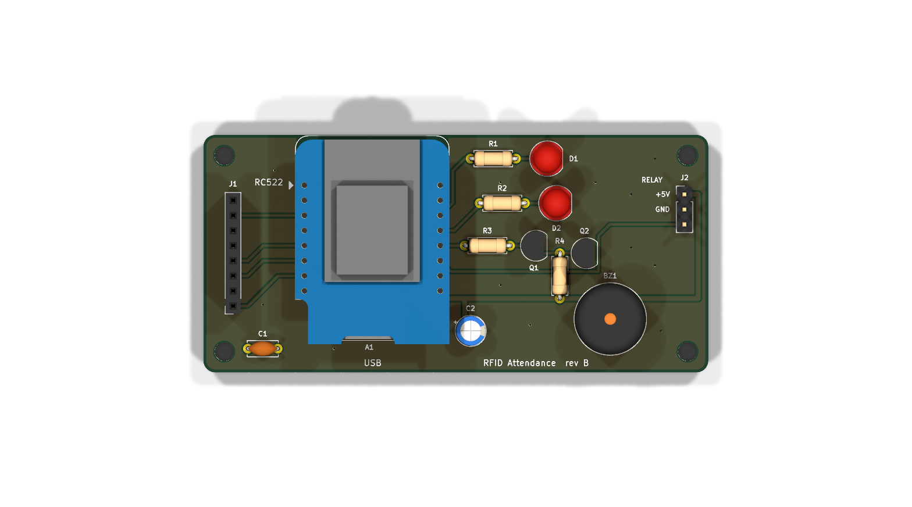
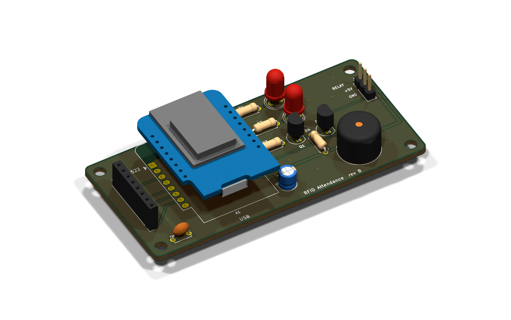
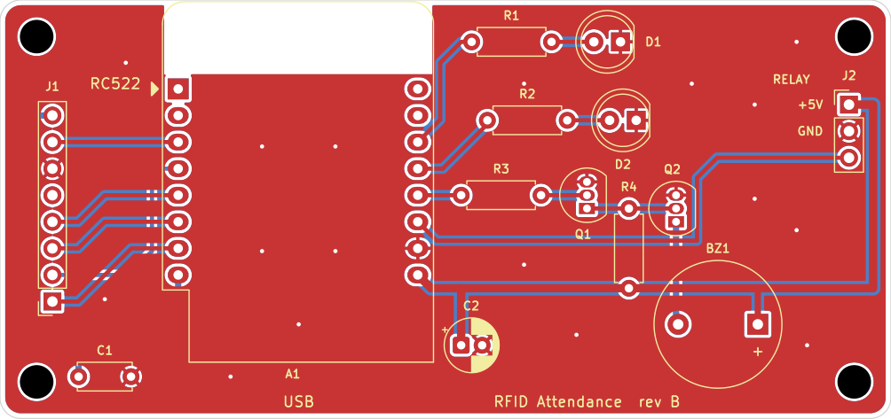
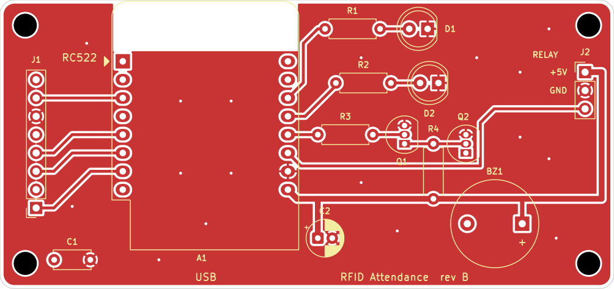
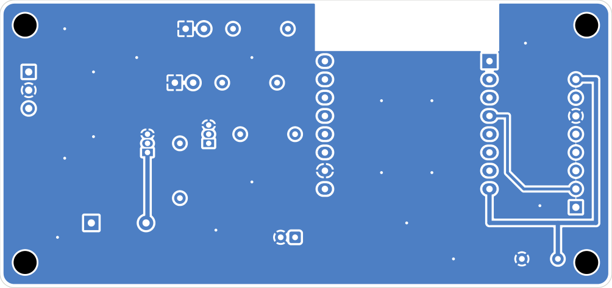
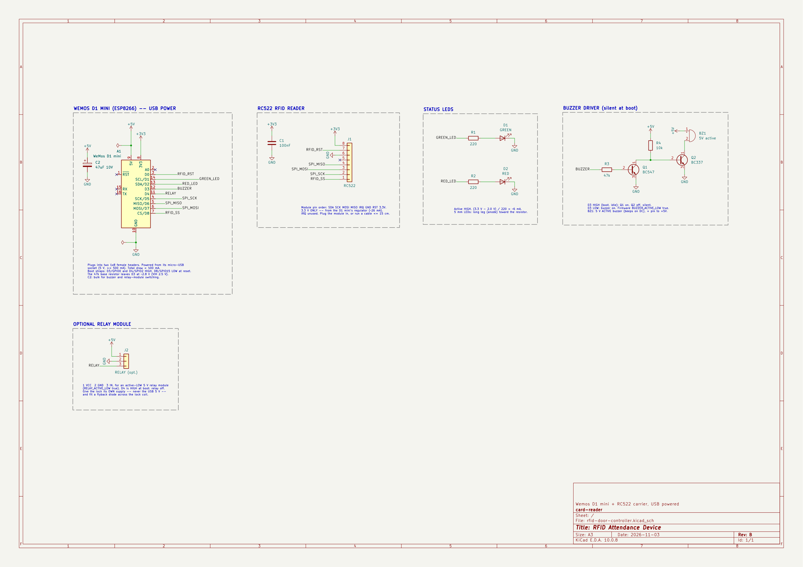

**English** | [فارسی](assembly-fa.md)

# Assembly guide: RFID attendance device

This guide takes you from loose parts to a working device: a Wemos D1 mini with an RC522
card reader, a green and a red LED, and a buzzer, all powered from one USB cable.
It takes about 1 to 2 hours.

**Contents:** [1. Parts](#1-parts) · [2. Tools](#2-tools) · [3. Circuit](#3-circuit) ·
[4. Flash the firmware first](#4-flash-the-firmware-first) · [5. Wire it up](#5-wire-it-up) ·
[6. Check before power](#6-check-before-power) · [7. First power-on](#7-first-power-on) ·
[8. Set up and register cards](#8-set-up-and-register-cards) · [9. Enclosure](#9-enclosure) ·
[10. Troubleshooting](#10-troubleshooting) · [11. Reference data](#11-reference-data)

---

## 1. Parts

| # | Part | Qty | Spec / notes |
|---|---|---|---|
| 1 | Wemos D1 mini | 1 | ESP8266, 4 MB flash. Clones with the CH340 USB chip work fine. |
| 2 | RC522 RFID module | 1 | 13.56 MHz, usually sold with 1 card and 1 key-fob tag. **3.3 V only.** |
| 3 | RFID cards or tags | as needed | 13.56 MHz, ISO 14443A (MIFARE Classic 1K, NTAG…) |
| 4 | LED, green, 5 mm | 1 | |
| 5 | LED, red, 5 mm | 1 | |
| 6 | Resistor 220 Ω, ¼ W | 2 | one per LED |
| 7 | Buzzer, **option A** | 1 | 3-pin buzzer module, **low-level trigger** (sounds when IN = LOW) |
| 7 | Buzzer, **option B** | 1 | bare 5 V *active* buzzer (beeps by itself on DC), plus the parts in rows 8 to 11 |
| 8 | Transistor BC547 (NPN) | 1 | option B only |
| 9 | Transistor BC337 (NPN) | 1 | option B only. A BC547 also works for a buzzer under 100 mA. |
| 10 | Resistor 47 kΩ | 1 | option B only |
| 11 | Resistor 10 kΩ | 1 | option B only |
| 12 | Breadboard or perfboard | 1 | perfboard plus soldering for a permanent build |
| 13 | Jumper wires (female-female / male-female) | ~15 | |
| 14 | Pin headers | 2 × 8 pins, 1 × 8 pins | usually included with the Wemos and the RC522 |
| 15 | Micro-USB cable | 1 | **must carry data**, not a charge-only cable |
| 16 | USB power adapter, 5 V | 1 | ≥ 500 mA. A PC port or power bank also works. |
| 17 | Enclosure | 1 | plastic, not metal (see [section 9](#9-enclosure)) |

**Which buzzer option?** Option A is simpler: three wires, no extra parts. Option B is
what the project's carrier board uses. Both keep the buzzer silent while the Wemos
starts up, which matters because the buzzer pin (D3) is a boot pin. Don't connect a
plain buzzer straight to D3.

## 2. Tools

- Soldering iron (fine tip, ~350 °C) and solder
- Multimeter (continuity and DC volts)
- Side cutters and wire strippers
- A computer with USB, for flashing the firmware
- Optional: a hot-glue gun for fixing parts in the enclosure

---

## 3. Circuit

```
                 USB 5 V
                    │
             ┌──────┴───────────────┐
             │     Wemos D1 mini    │
             │                      │
   RC522 ────┤ 3V3            5V ───┼──── buzzer +  (option B: driver, see 5.4)
   (3.3 V)   │ G (GND)              │
             │ D8 ── SDA/SS         │
             │ D5 ── SCK            │
             │ D7 ── MOSI           │
             │ D6 ── MISO           │
             │ D0 ── RST            │
             │                      │
             │ D1 ── 220 Ω ── LED green ── GND
             │ D2 ── 220 Ω ── LED red   ── GND
             │ D3 ── buzzer input (silent when HIGH)
             └──────────────────────┘
```

| From | To | Wire |
|---|---|---|
| RC522 **SDA** | Wemos **D8** | SPI chip select |
| RC522 **SCK** | Wemos **D5** | SPI clock |
| RC522 **MOSI** | Wemos **D7** | SPI data → reader |
| RC522 **MISO** | Wemos **D6** | SPI data → Wemos |
| RC522 **IRQ** | — | leave unconnected |
| RC522 **GND** | Wemos **G** | ground |
| RC522 **RST** | Wemos **D0** | reader reset |
| RC522 **3.3V** | Wemos **3V3** | ⚠ **never 5V** |
| LED green (via 220 Ω) | Wemos **D1** | long leg (+) toward the resistor |
| LED red (via 220 Ω) | Wemos **D2** | long leg (+) toward the resistor |
| Buzzer input | Wemos **D3** | see [5.4](#54-buzzer) |
| All GND | Wemos **G** | common ground |

### 3.1 Carrier PCB (optional)

Instead of perfboard and wires you can order the project's PCB. It makes every connection in the table above, uses buzzer option B, and only needs the parts soldered on (see [`hardware/README.md`](../hardware/README.md)).

The KiCad design is in [`hardware/`](../hardware/README.md): a 2-layer, 85 × 40 mm, all through-hole
board. The D1 mini and the RC522 plug into sockets, and the board carries the LEDs, the buzzer driver
(option B in the assembly guide) and a 3-pin header for an optional relay module. Gerbers:
[`hardware/fab/rfid-door-controller-gerbers.zip`](../hardware/fab/rfid-door-controller-gerbers.zip).

| 3D, top | 3D |
|---|---|
|  |  |

Routing (red = top copper, blue = bottom copper, both with a ground pour):



| Top copper | Bottom copper (seen from below) |
|---|---|
|  |  |

Schematic ([PDF](../hardware/rfid-door-controller-schematic.pdf)):



---

## 4. Flash the firmware first

Flashing before you wire anything proves the Wemos and cable are good, and gives you a
serial log for checking each step.

**1. Install the tools.**

```bash
pip install platformio          # or install the PlatformIO extension in VS Code
git clone https://github.com/Aryalleh/Attendance-device.git
cd Attendance-device/firmware
```

- **Windows:** if no COM port appears when you plug the Wemos in, install the CH340 driver.
- **Linux:** add yourself to the `dialout` group, then log out and back in:
  `sudo usermod -aG dialout $USER`

**2. Set the buzzer type.** Open `firmware/src/config.h` and set:

```cpp
#define BUZZER_ACTIVE_LOW  true    // option A (low-level trigger) and option B (transistor driver)
```

Leave `LED_ACTIVE_LOW false` if the LEDs are wired as shown in this guide.

**3. Build and upload.**

```bash
pio run -t upload
pio device monitor              # 115200 baud, Ctrl+C to exit
```

With nothing connected yet, the log should show:

```
[boot] RFID access controller 1.0.0
[boot] reader NOT FOUND (version 0x00), mode standalone, 0 cards
[rfid] 0x00: RC522 unpowered (3.3V/GND), held in reset (RST->D0), or MISO shorted to GND
```

"Reader not found" is expected at this point. **Unplug USB** before wiring.

---

## 5. Wire it up

Do all wiring **with USB unplugged**.

### 5.1 Headers

Solder the pin headers to the Wemos and the RC522, if they aren't soldered already.
On the RC522, put the header on the side **away from the antenna coil**.

### 5.2 RC522 reader

Connect the 7 wires from the [table above](#3-circuit). Double-check the **3.3V** wire: on
the Wemos it goes to the pin labelled **3V3**, not **5V**. 5 V can destroy the RC522.

Keep these wires short (under ~15 cm). Long SPI wires cause read errors.

### 5.3 LEDs

For each LED:

```
Wemos D1 ──[220 Ω]──►|── GND        (green)
Wemos D2 ──[220 Ω]──►|── GND        (red)
                  long  short
                  leg   leg (flat side of the LED body)
```

The **long leg** (anode, +) goes toward the resistor and the Wemos pin. The **short leg**
(cathode, −, next to the flat edge of the LED body) goes to GND.

### 5.4 Buzzer

**Option A: low-level-trigger module (3 pins)**

| Module pin | Wemos |
|---|---|
| VCC | 5V |
| GND | G |
| I/O (or IN) | D3 |

**Option B: bare 5 V active buzzer with a 2-transistor driver**

```
                         +5V                    +5V
                          │                      │
                       [10 kΩ]                 (+) buzzer
                          │                      │
 D3 ──[47 kΩ]──B  Q1      ├──────────B  Q2      (−)
                 BC547    │            BC337     │
                C ────────┘           C ─────────┘
                E ── GND              E ── GND
```

How it works:

- **D3 HIGH** (at boot and when idle): Q1 turns on and pulls Q2's base low, so Q2 is off and the buzzer is silent.
- **D3 LOW**: Q1 turns off, the 10 kΩ resistor turns Q2 on, and the buzzer sounds.

This is why the firmware setting is `BUZZER_ACTIVE_LOW true`.

**Transistor pins (BC547 and BC337, TO-92):** hold it with the **flat face toward you** and
the legs down. From left to right the legs are **C – B – E** (collector, base, emitter).
Some makers differ, so check the datasheet or test with the multimeter's diode/hFE mode.

The buzzer's **+** (longer leg, or the side marked "+") goes to 5V.

---

## 6. Check before power

With USB still unplugged, set the multimeter to continuity:

| Measure between | Expected |
|---|---|
| Wemos 5V ↔ G | **no beep** (no short) |
| Wemos 3V3 ↔ G | **no beep** |
| RC522 3.3V ↔ Wemos 3V3 | beep |
| RC522 GND ↔ Wemos G | beep |
| Each RC522 signal pin ↔ its Wemos pin (SDA–D8, SCK–D5, MOSI–D7, MISO–D6, RST–D0) | beep |
| RC522 3.3V ↔ Wemos 5V | **no beep** |

Fix anything unexpected before you connect power.

---

## 7. First power-on

Plug in USB and open the serial monitor (`pio device monitor`). You should see:

```
[boot] RFID access controller 1.0.0
[boot] reader OK (version 0x92), mode standalone, 0 cards
[wifi] setup AP "RFID-Setup-xxxxxx" pass "rfid12345" at 192.168.4.1
```

- `version 0x92` (or `0x91`, `0x88`, `0xB2`) means the RC522 is wired correctly.
- The green and red LEDs and the buzzer play a short start-up pattern.
- **The buzzer must stay silent while the board starts.** If it beeps constantly, see [Troubleshooting](#10-troubleshooting).
- Hold a card on the reader. The log shows `[scan] 04:A3:1B:2C`, and the red LED with a beep means "unknown card". That's correct, because no cards are registered yet.

---

## 8. Set up and register cards

1. On your phone or PC, connect to the Wi-Fi **`RFID-Setup-xxxxxx`**, password **`rfid12345`**.
2. Open **http://192.168.4.1** and log in with **admin / admin**.
3. In **Settings**:
   - **Change the admin password.**
   - Choose the mode: **Standalone** (cards stored on the device) or **Server** (see the [README](../README.md#server-mode)).
   - Enter your Wi-Fi name and password, or tick "No router" («بدون روتر») to keep the device's own Wi-Fi.
   - Press **Save & reboot** («ذخیره و راه‌اندازی مجدد»).
4. **Register cards (standalone):** on the **Cards** tab, type the person's name, press **Scan to add** («ثبت با کارت‌زدن»), and hold their card on the reader. The LEDs blink green/red while it waits.
5. Test: hold a registered card on the reader. You should get green and a short beep, and the **Log** tab shows the entry.

---

## 9. Enclosure

- **Plastic, not metal.** Metal near the RC522 antenna blocks the reader. Mount the antenna
  directly behind the front wall, with the wall no more than ~3 mm thick. Expect a read
  range of 2 to 4 cm.
- Keep the Wemos and its wires **at least 1 to 2 cm away from the antenna**, or behind it.
- Drill 5 mm holes for the LEDs, and a hole or slot over the buzzer so it can be heard.
- Leave the Wemos's **USB port reachable** for power and future firmware updates.
- Fix the boards with screws, standoffs or hot glue so nothing can short against anything else.
- Label the front with a card symbol where people should tap.

---

## 10. Troubleshooting

| Symptom | Likely cause | Fix |
|---|---|---|
| No COM / `/dev/ttyUSB0` port | charge-only cable, missing driver, or Linux permissions | use a data cable; install the CH340 driver; `sudo usermod -aG dialout $USER` |
| Upload fails: "Timed out waiting for packet header" | bad cable or port busy | close other serial monitors; try `--upload-speed 115200`; try another cable |
| Log: `reader NOT FOUND (version 0x00)` | RC522 has no power, RST held low, or MISO shorted to GND | check the 3.3V and GND wires and RST → D0 |
| Log: `reader NOT FOUND (version 0xFF)` | MISO not connected, or SDA not wired | check MISO → D6 and SDA → D8 |
| Board won't start, or the log stops after garbage characters | something pulls **D3 low** or **D8 high** at boot | disconnect the buzzer and check; use buzzer option A or B, not a plain buzzer on D3 |
| Buzzer beeps constantly at power-on | wrong polarity setting | set `BUZZER_ACTIVE_LOW true` in `config.h` and upload again |
| Buzzer never beeps | wrong polarity, or buzzer reversed | check the `BUZZER_ACTIVE_LOW` setting and the buzzer's +/− |
| An LED never lights | LED reversed | swap its legs: long leg toward the resistor |
| Cards read only at 0 to 1 cm, or not at all | metal nearby, long SPI wires, or a weak supply | move the antenna away from metal; shorten wires; try another USB adapter |
| Some cards are never read | not 13.56 MHz ISO 14443A (for example a 125 kHz card) | use 13.56 MHz cards |
| Short red flash every 3 s | server mode: server unreachable | check the server URL, the device key and the network |

---

## 11. Reference data

### Wemos D1 mini pins used

| Label | GPIO | Used for | Boot requirement |
|---|---|---|---|
| D0 | GPIO16 | RC522 RST | — |
| D1 | GPIO5 | green LED | — |
| D2 | GPIO4 | red LED | — |
| D3 | GPIO0 | buzzer | **must be HIGH at boot** |
| D4 | GPIO2 | on-board LED / optional relay | **must be HIGH at boot** |
| D5 | GPIO14 | SPI SCK | — |
| D6 | GPIO12 | SPI MISO | — |
| D7 | GPIO13 | SPI MOSI | — |
| D8 | GPIO15 | RC522 SDA (SS) | **must be LOW at boot** (the RC522 doesn't interfere) |

### Power budget (from USB 5 V)

| Load | Typical current |
|---|---|
| Wemos D1 mini with Wi-Fi | 70 to 170 mA average, short peaks up to ~350 mA |
| RC522 (from 3V3) | 13 to 26 mA |
| 2 LEDs (220 Ω) | ~5 to 6 mA each, only one lit at a time |
| Buzzer | ~30 mA while beeping |
| **Total** | **under 400 mA**: any 5 V / 500 mA USB supply is enough |

### Firmware settings (`firmware/src/config.h`)

| Setting | Value for this guide | Meaning |
|---|---|---|
| `LED_ACTIVE_LOW` | `false` | LEDs light when the pin is HIGH |
| `BUZZER_ACTIVE_LOW` | `true` | buzzer sounds when D3 is LOW (options A and B) |
| `SCAN_REPEAT_MS` | `2000` | the same card held on the reader is ignored for 2 s |
| `MAX_CARDS` | `200` | cards stored on the device |

### Default credentials (change them!)

| What | Default |
|---|---|
| Setup Wi-Fi | `RFID-Setup-xxxxxx` / `rfid12345` |
| Device panel | http://192.168.4.1, `admin` / `admin` |
