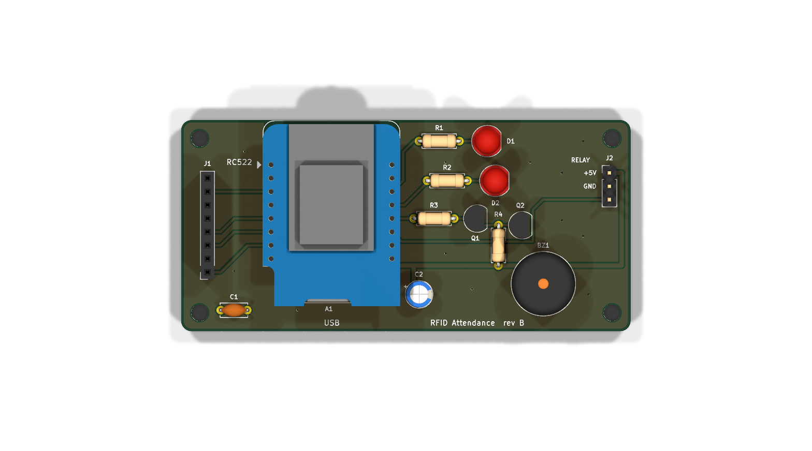
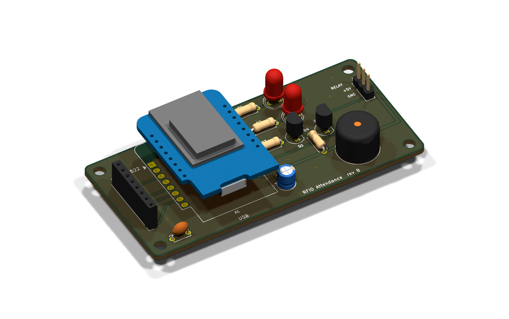
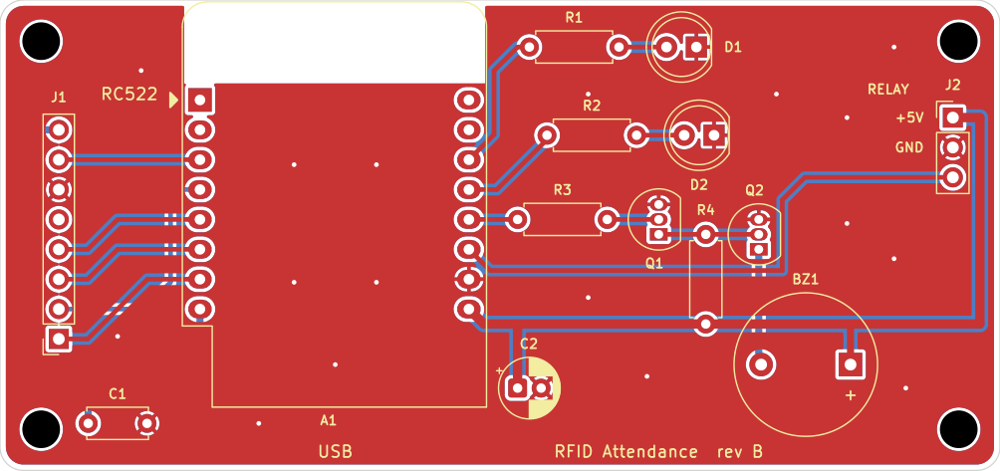
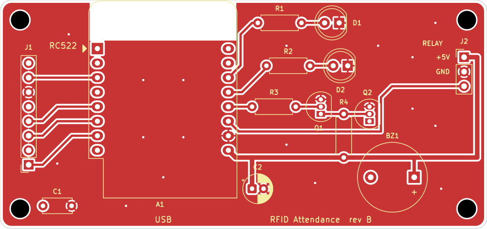
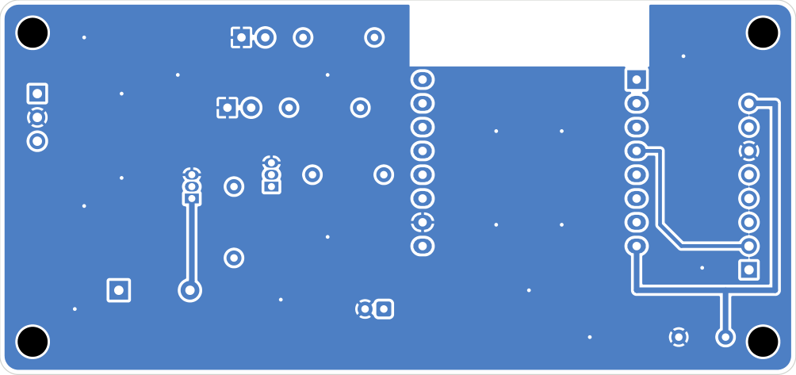
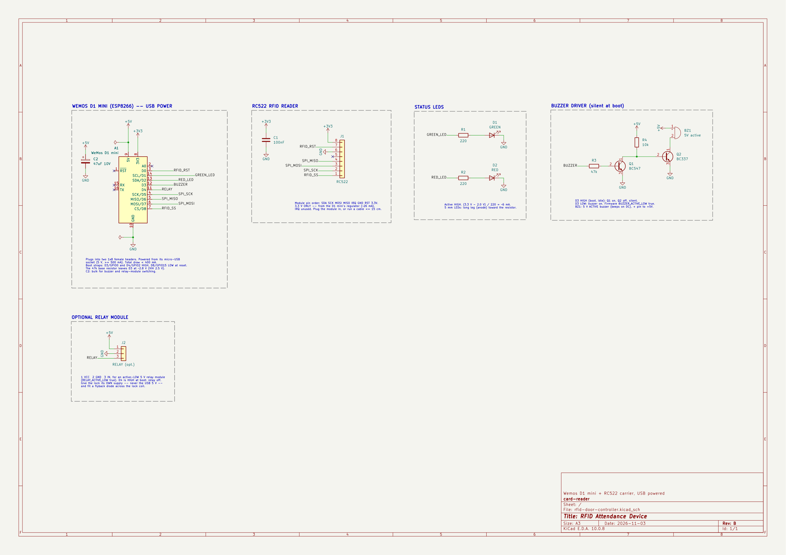

<div dir="rtl">

# پروپوزال پروژه: سامانهٔ حضور و غیاب و کنترل تردد مبتنی بر RFID

| | |
|---|---|
| **عنوان** | طراحی و پیاده‌سازی سامانهٔ حضور و غیاب با کارت RFID، پنل مدیریت تحت وب و نمایشگر زندهٔ کنار در |
| **دانشجو** | ………………………… |
| **استاد راهنما** | ………………………… |
| **تاریخ** | ۱۲ آبان ۱۴۰۵ |
| **وضعیت** | نمونهٔ اولیه (Prototype) ساخته و آزمایش شده است |

---

## ۱. چکیده

در این پروژه یک سامانهٔ کامل حضور و غیاب و کنترل تردد طراحی و ساخته شده است. کاربر کارت RFID خود را نزدیک دستگاه می‌کند. دستگاه شناسهٔ کارت را می‌خواند و نتیجه را با LED و بازر اعلام می‌کند: برای کارت مجاز، چراغ سبز و بوق کوتاه؛ برای کارت ناشناس، مسدود یا منقضی، چراغ قرمز و هشدار صوتی. همهٔ ورودها و خروج‌ها با تاریخ و ساعت ثبت می‌شوند.

سامانه سه بخش دارد:

1. **سخت‌افزار:** بُرد Wemos D1 mini (ESP8266)، ماژول RC522، LED و بازر. تغذیه مستقیم از USB.
2. **نرم‌افزار دستگاه (Firmware):** به زبان C++. در دو حالت «مستقل» و «متصل به سرور» کار می‌کند.
3. **سرور و پنل مدیریت:** Python (Flask) و SQLite، قابل اجرا روی Raspberry Pi یا هر سیستم لینوکسی. پنل کاملاً فارسی است و از تقویم شمسی استفاده می‌کند.

یکی از ویژگی‌های مهم پروژه **نمایشگر زندهٔ کنار در** است. یک صفحهٔ وب تمام‌صفحه برای تبلت یا مانیتور که نام فرد و نتیجهٔ کارت‌زدن را همراه با صدا نشان می‌دهد و **بدون نیاز به ورود (Login)** با یک لینک امن اختصاصی باز می‌شود.

---

## ۲. بیان مسئله و انگیزه

ثبت دستی حضور و غیاب در محیط‌هایی مانند آزمایشگاه، کلاس، دفتر کار یا اتاق تیم مشکلات زیر را دارد:

- وقت‌گیر است و خطای انسانی دارد.
- مشخص نیست چه کسی و چه زمانی وارد یا خارج شده است.
- گزارش‌گیری (اولین ورود، آخرین خروج، مدت حضور) دشوار است.
- دستگاه‌های تجاری گران‌اند، پنل فارسی و تقویم شمسی ندارند و قابل توسعه نیستند.

هدف پروژه ساخت سامانه‌ای **کم‌هزینه، متن‌باز، فارسی و قابل توسعه** است که در صورت قطع سرور هم از کار نیفتد.

---

## ۳. اهداف

| # | هدف | وضعیت |
|---|---|---|
| ۱ | شناسایی کارت با RC522 و اعلام نتیجه با LED و بازر | ✅ انجام شد |
| ۲ | رد کارت ناشناس/مسدود/منقضی با هشدار صوتی و نوری | ✅ انجام شد |
| ۳ | ثبت تاریخ و ساعت ورود و خروج در پایگاه داده | ✅ انجام شد |
| ۴ | افزودن، ویرایش، مسدود کردن و حذف کارت از پنل وب | ✅ انجام شد |
| ۵ | گزارش تردد، خروجی اکسل و گزارش حضور و غیاب روزانه | ✅ انجام شد |
| ۶ | ادامهٔ کار در زمان قطع سرور (حالت آفلاین) | ✅ انجام شد |
| ۷ | نمایشگر زندهٔ کنار در بدون نیاز به ورود | ✅ انجام شد |
| ۸ | طراحی بُرد حامل (PCB) | 🔄 در حال انجام |

---

## ۴. معماری کلی سامانه

```
                  ┌────────────── حالت سرور ──────────────┐
کارت ─► RC522 ─► Wemos D1 mini ──── Wi-Fi / HTTP ────► سرور Flask + SQLite
          SPI      │  LED سبز و قرمز، بازر               پنل مدیریت
                   │                                       │
                   │                                       └──► نمایشگر زندهٔ کنار در (تبلت/مانیتور)
                   └─ حالت مستقل: لیست کارت‌ها، گزارش و پنل روی خود دستگاه
```

### ۴-۱. دو حالت کاری

| | **حالت سرور** | **حالت مستقل** |
|---|---|---|
| تصمیم‌گیرنده | سرور | خود دستگاه |
| محل نگهداری کارت‌ها و گزارش | پایگاه داده روی سرور | حافظهٔ فلش دستگاه (تا ۲۰۰ کارت و حدود ۲۰۰۰ رکورد) |
| پنل مدیریت | پنل سرور | پنل داخلی دستگاه |
| چند دستگاه | بله، با لیست کارت مشترک | هر دستگاه مستقل است |
| قطع سرور | دستگاه با لیست کارت ذخیره‌شده (Cache) کار می‌کند و رویدادها بعداً ارسال می‌شوند | — |
| نیاز به مودم | بله | خیر، دستگاه می‌تواند Wi-Fi اختصاصی خودش را بسازد |

حالت مستقل برای تیم‌های کوچک بدون سرور مناسب است. حالت سرور برای سازمان‌هایی با چند دستگاه و نیاز به گزارش‌گیری متمرکز.

---

## ۵. سخت‌افزار

### ۵-۱. قطعات

| قطعه | توضیح |
|---|---|
| Wemos D1 mini (ESP8266) | میکروکنترلر ۸۰ مگاهرتزی با Wi-Fi داخلی و ۴ مگابایت فلش |
| ماژول RC522 + کارت/تگ ۱۳٫۵۶ مگاهرتز | خوانندهٔ RFID. **فقط با ولتاژ ۳٫۳ ولت** کار می‌کند |
| LED سبز و قرمز + دو مقاومت ۲۲۰ اهم | نمایش نتیجه |
| بازر فعال ۵ ولت + طبقهٔ ترانزیستوری | هشدار صوتی |
| کابل و آداپتور USB ۵ ولت | تغذیهٔ کل دستگاه |

### ۵-۲. تغذیه

کل دستگاه **مستقیماً از USB** تغذیه می‌شود و منبع تغذیهٔ جداگانه لازم نیست:

- ولتاژ ۵ ولت USB از طریق کانکتور Micro-USB وارد Wemos می‌شود.
- رگولاتور داخلی Wemos ولتاژ **۳٫۳ ولت** را برای RC522 و منطق ESP8266 می‌سازد.
- بازر از پایهٔ **5V** بُرد Wemos تغذیه می‌شود.
- مصرف کل زیر ۴۰۰ میلی‌آمپر است و هر آداپتور USB معمولی، پاوربانک یا پورت USB کامپیوتر کافی است.

### ۵-۳. اتصالات

| RC522 | Wemos | | ماژول | Wemos |
|---|---|---|---|---|
| SDA (SS) | D8 | | LED سبز | D1 |
| SCK | D5 | | LED قرمز | D2 |
| MOSI | D7 | | بازر | D3 |
| MISO | D6 | | | |
| RST | D0 | | | |
| 3.3V | 3V3 | | | |
| GND | G | | | |

پایه‌های D5، D6 و D7 همان SPI سخت‌افزاری ESP8266 هستند و قابل تغییر نیستند.

### ۵-۴. نکتهٔ طراحی: پایهٔ بوت و بازر

پایهٔ D3 (GPIO0) در ESP8266 یک **پایهٔ بوت** است. هنگام روشن شدن باید در سطح HIGH باشد، وگرنه بُرد به‌جای اجرای برنامه وارد حالت پروگرام می‌شود. اگر بازر مستقیم به این پایه وصل شود، یا هنگام روشن شدن بی‌دلیل صدا می‌دهد، یا ورودی آن پایه را LOW می‌کند و بُرد بالا نمی‌آید.

برای رفع این مشکل، بازر از طریق یک **طبقهٔ معکوس‌کنندهٔ ترانزیستوری** (BC547 + BC337) راه‌اندازی می‌شود. بازر با LOW شدن پایه روشن می‌شود و در زمان بوت ساکت می‌ماند. در Firmware کافی است `BUZZER_ACTIVE_LOW` برابر `true` باشد.

### ۵-۵. علائم دستگاه

| آنچه دیده یا شنیده می‌شود | معنی |
|---|---|
| بوق کوتاه + LED سبز | کارت مجاز؛ ورود یا خروج ثبت شد |
| سه بار LED قرمز + بوق | کارت مسدود یا منقضی |
| یک LED قرمز طولانی + بوق | کارت ناشناس |
| LED سبز و قرمز به‌تناوب | منتظر کارت برای ثبت کارت جدید (حالت مستقل) |
| چشمک کوتاه قرمز هر ۳ ثانیه | سرور در دسترس نیست (کار با لیست ذخیره‌شده) |
| چشمک آهستهٔ قرمز | Wi-Fi راه‌اندازی دستگاه فعال است |
| سه بار LED قرمز بدون صدا در زمان روشن شدن | RC522 پیدا نشد؛ سیم‌کشی را بررسی کنید |

### ۵-۶. بُرد مدار چاپی

طرح KiCad در پوشهٔ [`hardware/`](../hardware/README.md) است: بُرد دولایه، ۸۵ × ۴۰ میلی‌متر و تمام قطعات
از نوع پایه‌دار (THT). Wemos D1 mini و RC522 روی سوکت قرار می‌گیرند و LEDها، مدار راه‌انداز بازر
(گزینهٔ ب راهنمای مونتاژ) و یک هدر سه‌پین برای ماژول رلهٔ اختیاری روی خود بُرد هستند.
فایل‌های ساخت (Gerber): [`hardware/fab/rfid-door-controller-gerbers.zip`](../hardware/fab/rfid-door-controller-gerbers.zip).

| نمای سه‌بعدی از بالا | نمای سه‌بعدی |
|---|---|
|  |  |

مسیرکشی (قرمز = مس رو، آبی = مس پشت؛ هر دو لایه با سطح زمین پر شده‌اند):



| مس لایهٔ رو | مس لایهٔ پشت (از زیر) |
|---|---|
|  |  |

شماتیک ([PDF](../hardware/rfid-door-controller-schematic.pdf)):



---

## ۶. نرم‌افزار دستگاه (Firmware)

**زبان:** C++ (Arduino framework) با PlatformIO. حدود ۱۳۰۰ خط کد.

> نمونه‌کدهای این بخش و بخش‌های بعد مستقیماً از کد پروژه برداشته شده‌اند. بعضی برای خوانایی کمی خلاصه شده‌اند (مثلاً خطوط ثبت گزارش حذف شده‌اند).

| فایل | وظیفه |
|---|---|
| `main.cpp` | حلقهٔ اصلی، خواندن کارت، تصمیم‌گیری، ارتباط با سرور، Wi-Fi، پنل وب داخلی |
| `config.h` | پایه‌ها، قطبیت ماژول‌ها و ثابت‌های زمانی |
| `settings.h` | تنظیمات (Wi-Fi، سرور، کلید دستگاه، رمز پنل)، ذخیره در `/config.json` |
| `storage.h` | لیست کارت‌ها و گزارش‌ها روی فایل‌سیستم LittleFS |
| `feedback.h` | الگوهای غیرمسدودکنندهٔ LED و بازر |
| `panel_html.h` | پنل وب فارسی داخل دستگاه |

### ۶-۱. خواندن شناسهٔ کارت

```cpp
void pollReader() {
  if (!rfid.PICC_IsNewCardPresent() || !rfid.PICC_ReadCardSerial()) return;
  String uid;
  char b[4];
  for (byte i = 0; i < rfid.uid.size; i++) {
    snprintf(b, sizeof(b), i ? ":%02X" : "%02X", rfid.uid.uidByte[i]);
    uid += b;
  }
  rfid.PICC_HaltA();
  rfid.PCD_StopCrypto1();
  handleCard(uid);
}
```

**توضیح:** این تابع هر ۵۰ میلی‌ثانیه در حلقهٔ اصلی اجرا می‌شود. اگر کارت تازه‌ای نزدیک خواننده نباشد، بلافاصله برمی‌گردد. در غیر این صورت، بایت‌های شناسهٔ کارت (UID، معمولاً ۴ یا ۷ بایت) به رشتهٔ هگز خوانا مثل `04:A3:1B:2C` تبدیل می‌شوند. سپس کارت به حالت توقف (Halt) می‌رود تا تا دور شدن دوباره خوانده نشود، و شناسه برای تصمیم‌گیری به `handleCard` داده می‌شود. در `handleCard` اگر همان کارت در کمتر از ۲ ثانیه دوباره خوانده شود، نادیده گرفته می‌شود تا یک بار نگه داشتن کارت دو بار ثبت نشود.

### ۶-۲. تصمیم‌گیری در حالت سرور با پشتیبان آفلاین

```cpp
void handleServerScan(const String& uid) {
  if (WiFi.status() == WL_CONNECTED && S.serverUrl.length()) {
    JsonDocument req, resp;
    req["uid"] = uid;
    int code = postJson("/api/v1/scan", req, resp);
    if (code == 200) {
      bool granted = resp["granted"] | false;
      String result = resp["result"] | (granted ? "granted" : "denied");
      if (granted) grant(resp["open_ms"] | 3000);
      else fb.play(result == "unknown" ? Patterns::UNKNOWN : Patterns::DENIED);
      return;
    }
    Serial.printf("[scan] server error %d, using offline mode\n", code);
  }
  // سرور پاسخ نداد: تصمیم با لیست ذخیره‌شده
  String name, dir;
  const char* result = decideLocal(cacheCards, uid, name, dir);
  offlineQ.push(nowTs(), uid, result, dir);   // بعداً به سرور ارسال می‌شود
}
```

**توضیح:** دستگاه ابتدا شناسهٔ کارت را به‌صورت JSON برای سرور می‌فرستد و منتظر پاسخ می‌ماند (حداکثر ۱٫۵ ثانیه). اگر سرور پاسخ دهد، دستگاه فقط نتیجه را اجرا می‌کند: برای کارت مجاز چراغ سبز و بوق (`grant`)، و برای کارت ناشناس یا مسدود الگوی هشدار مخصوص آن. اگر شبکه یا سرور قطع باشد، دستگاه متوقف نمی‌شود. با لیست کارتی که قبلاً از سرور گرفته (`cacheCards`) تصمیم می‌گیرد و رویداد را در **صف آفلاین** روی حافظهٔ فلش ذخیره می‌کند. با برگشتن سرور، این رویدادها ارسال و با برچسب «آفلاین» ثبت می‌شوند. به این طراحی **تحمل خطا (Fault Tolerance)** می‌گویند.

### ۶-۳. تشخیص ورود یا خروج

```cpp
const char* decideLocal(CardStore& store, const String& uid, String& name, String& dir) {
  Card* c = store.find(uid);
  if (!c) { fb.play(Patterns::UNKNOWN); return "unknown"; }
  name = c->name;
  if (!c->enabled) { fb.play(Patterns::DENIED); return "denied"; }
  dir = S.isServerMode() ? String("toggle") : S.direction;
  if (dir == "toggle") dir = c->inside ? "out" : "in";
  c->inside = dir == "in";
  markCardsDirty();
  grant(S.openMs);
  return "granted";
}
```

**توضیح:** کارت در لیست جستجو می‌شود. اگر نباشد «ناشناس» و اگر غیرفعال باشد «مسدود» است. برای کارت مجاز، جهت تردد تعیین می‌شود. در حالت **متناوب (toggle)** دستگاه به خاطر می‌سپارد هر نفر الان داخل است یا بیرون (`inside`). کارت‌زدن بعدی خلاف آن ثبت می‌شود: ورود ← خروج ← ورود. به این ترتیب فقط با یک دستگاه، هم ورود و هم خروج ثبت می‌شود. وضعیت داخل/بیرون با تأخیر روی فلش ذخیره می‌شود (`markCardsDirty`) تا حافظهٔ فلش با نوشتن‌های پی‌درپی فرسوده نشود.

### ۶-۴. همگام‌سازی با سرور (Heartbeat)

دستگاه هر ۵ ثانیه به `POST /api/v1/sync` درخواست می‌فرستد. با این درخواست:

- ساعت دستگاه با سرور تنظیم می‌شود.
- اگر لیست کارت‌ها تغییر کرده باشد (`cards_version`)، لیست جدید دریافت و روی فلش ذخیره می‌شود.
- رویدادهای آفلاین به سرور ارسال می‌شوند.
- سرور می‌فهمد دستگاه آنلاین است و وضعیت آن را در پنل نشان می‌دهد.

### ۶-۵. پروتکل دستگاه و سرور

همهٔ درخواست‌ها هدر `X-Device-Key` دارند.

| درخواست | بدنه | پاسخ |
|---|---|---|
| `POST /api/v1/scan` | `{"uid":"04:A3:1B:2C"}` | `{"granted":true,"result":"granted","name":"سارا","direction":"in"}` |
| `POST /api/v1/sync` | `{"fw":"1.0.0","cards_version":"…","events":[…]}` | `{"time":…,"cards_version":"…"}` |
| `GET /api/v1/cards` | — | سطرهای TSV: `uid ⇥ 1 ⇥ inside ⇥ name` |

---

## ۷. سرور و پنل مدیریت

- **زبان و کتابخانه‌ها:** Python، Flask، سرور waitress. حدود ۱۰۰۰ خط کد.
- **محل اجرا:** Raspberry Pi یا هر سیستم لینوکسی در شبکهٔ محلی، به‌صورت سرویس systemd.
- **پایگاه داده:** SQLite در حالت WAL با پنج جدول:

| جدول | محتوا |
|---|---|
| `cards` | شناسهٔ کارت، نام، توضیحات، فعال/مسدود، تاریخ اعتبار |
| `devices` | دستگاه‌ها: نام، کلید دستگاه، جهت (ورود/خروج/متناوب)، آخرین اتصال |
| `events` | همهٔ رویدادها: زمان، دستگاه، کارت، نام در آن لحظه، نتیجه، جهت، آفلاین بودن |
| `users` | کاربران پنل و هش رمز عبور |
| `meta` | شمارندهٔ نسخهٔ لیست کارت‌ها |

نام فرد در زمان رویداد در جدول `events` کپی می‌شود تا با حذف کارت، سوابق گذشته از بین نرود.

### ۷-۱. یکسان‌سازی شناسهٔ کارت

```python
_UID_HEX = re.compile(r"[^0-9A-F]")

def normalize_uid(raw):
    """'04 a3 1b 2c' / '04a31b2c' / '04:A3:1B:2C' -> '04:A3:1B:2C' (or '' if invalid)."""
    hexs = _UID_HEX.sub("", (raw or "").upper())
    if not 8 <= len(hexs) <= 20 or len(hexs) % 2:
        return ""
    return ":".join(hexs[i:i + 2] for i in range(0, len(hexs), 2))
```

**توضیح:** شناسهٔ کارت ممکن است از دستگاه یا از فرم پنل (تایپ دستی) با شکل‌های مختلف بیاید: با فاصله، بدون جداکننده، حروف کوچک. این تابع همه را به یک شکل استاندارد تبدیل می‌کند. ابتدا هر چیزی جز ارقام هگز حذف می‌شود، سپس طول بررسی می‌شود (۴ تا ۱۰ بایت، و تعداد ارقام زوج). در آخر رقم‌ها دوتا دوتا با `:` جدا می‌شوند. با این کار یک کارت هرگز با دو شکل متفاوت در پایگاه داده ثبت نمی‌شود، و ورودی نامعتبر از همان ابتدا رد می‌شود.

### ۷-۲. تصمیم‌گیری روی سرور

```python
@app.post("/api/v1/scan")
@device_required
def api_scan():
    db, dev = get_db(), g.device
    uid = normalize_uid((request.get_json(silent=True) or {}).get("uid"))
    if not uid:
        return jsonify(error="invalid uid"), 400

    card = db.execute("SELECT * FROM cards WHERE uid = ?", (uid,)).fetchone()
    if not dev["enabled"]:
        result = "denied"
    elif card is None:
        result = "unknown"
    else:
        valid = store.card_valid(card)          # 'ok' | 'disabled' | 'expired'
        result = "granted" if valid == "ok" else valid

    direction = ""
    if result == "granted":
        direction = dev["direction"]
        if direction == "toggle":
            direction = "out" if store.last_direction(db, card["id"]) == "in" else "in"

    store.add_event(db, ts=now(), device_id=dev["id"], uid=uid, card=card,
                    result=result, direction=direction)
    db.commit()
    return jsonify(granted=result == "granted", result=result,
                   name=card["name"] if card else "", direction=direction)
```

**توضیح:** این مهم‌ترین مسیر سرور است.

- **احراز هویت دستگاه:** دکوراتور `@device_required` پیش از اجرای تابع، کلید دستگاه را از هدر `X-Device-Key` بررسی می‌کند و دستگاه ناشناس را با خطای ۴۰۱ رد می‌کند.
- **ترتیب تصمیم:** دستگاه غیرفعال ← کارت ناشناس ← کارت مسدود یا منقضی ← مجاز.
- **جهت تردد:** در حالت متناوب، جهت از روی **آخرین تردد مجاز همان کارت در پایگاه داده** تعیین می‌شود، پس اگر فرد از دو دستگاه مختلف رد شود هم درست کار می‌کند.
- **ثبت:** هر کارت‌زدن، چه مجاز چه غیرمجاز، در جدول `events` ثبت می‌شود.
- **امنیت پرس‌وجو:** پرس‌وجوها با `?` پارامتری هستند تا تزریق SQL ممکن نباشد.

### ۷-۳. نسخهٔ لیست کارت‌ها

```python
def cards_version(db):
    """Changes whenever the card list changes, and daily (so expiries propagate)."""
    rev = db.execute("SELECT value FROM meta WHERE key = 'cards_rev'").fetchone()[0]
    return f"{rev}-{date.today().isoformat()}"
```

**توضیح:** دستگاه نباید هر ۵ ثانیه کل لیست کارت‌ها را دانلود کند. به‌جای آن سرور یک «نسخه» برمی‌گرداند و دستگاه فقط وقتی نسخه عوض شود لیست را می‌گیرد. نسخه از دو بخش ساخته شده است:

- **شمارنده:** با هر افزودن، ویرایش یا حذف کارت یکی زیاد می‌شود.
- **تاریخ امروز:** با شروع هر روز نسخه خودبه‌خود عوض می‌شود. در نتیجه کارتی که تاریخ اعتبارش دیروز تمام شده، از لیست آفلاین دستگاه هم حذف می‌شود، بدون اینکه مدیر کاری انجام دهد.

### ۷-۴. صفحات پنل

پنل کاملاً **فارسی و راست‌به‌چپ** است، تاریخ‌ها **شمسی** با ارقام فارسی نمایش داده می‌شوند و فونت وزیرمتن داخل خود پروژه است (بدون نیاز به اینترنت). تبدیل تاریخ شمسی و میلادی بدون کتابخانهٔ خارجی پیاده‌سازی شده است.

| صفحه | امکانات |
|---|---|
| **نمایشگر** | صفحهٔ زندهٔ کنار در (بخش ۸) |
| **داشبورد** | افراد داخل، آمار امروز، وضعیت آنلاین دستگاه‌ها، کارت‌های ثبت‌نشده |
| **کارت‌ها** | افزودن، ویرایش، مسدود/مجاز کردن، تاریخ انقضا، سوابق هر کارت |
| **دستگاه‌ها** | تعریف دستگاه، جهت (ورود/خروج/متناوب)، ساخت کلید دستگاه، لینک نمایشگر |
| **گزارش تردد** | جستجو و فیلتر بر اساس نام، شناسه، نتیجه، دستگاه و بازهٔ تاریخ؛ خروجی اکسل (CSV) |
| **حضور و غیاب** | اولین ورود، آخرین خروج و مدت حضور هر نفر در هر روز |
| **تنظیمات** | کاربران پنل، تغییر رمز، حذف رویدادهای قدیمی |

**ثبت کارت جدید:** کافی است کارت ناشناس جلوی دستگاه گرفته شود. شناسهٔ آن در داشبورد زیر «کارت‌های ثبت‌نشده» با دکمهٔ «ثبت کارت» ظاهر می‌شود و نیازی به تایپ شناسه نیست.

**اتصال به سرویس‌های دیگر:** هر رویداد می‌تواند به‌صورت JSON به یک Webhook (مثلاً Node-RED، Home Assistant یا ربات تلگرام) ارسال شود. یک API فقط‌خواندنی با توکن هم برای دریافت لیست حاضران و رویدادها وجود دارد.

---

## ۸. نمایشگر زندهٔ کنار در (بدون نیاز به ورود)

### ۸-۱. کارکرد

یک صفحهٔ وب تمام‌صفحه برای تبلت یا مانیتور کنار در:

- با کارت‌زدن مجاز، دایرهٔ سبز ✓ با پیام «خوش آمدید» یا «خدانگهدار» و نام فرد نمایش داده می‌شود.
- با کارت‌زدن غیرمجاز، دایرهٔ قرمز ✗ با پیام «دسترسی رد شد» و دلیل آن (ناشناس، مسدود، منقضی) نمایش داده می‌شود.
- **صدا با Web Audio API** تولید می‌شود (بدون فایل صوتی): صدای زنگ بالارونده برای مجاز و بوق بم برای رد.
- ساعت و تاریخ شمسی، نوار ۱۰ تردد اخیر و نشانگر آنلاین/آفلاین بودن دستگاه نمایش داده می‌شود.
- دکمهٔ تمام‌صفحه دارد و با Wake Lock از خاموش شدن صفحهٔ تبلت جلوگیری می‌کند.

### ۸-۲. چرا بدون ورود؟

تبلت کنار در باید همیشه روشن و آماده باشد. اگر نمایشگر نیاز به ورود داشت:

- رمز مدیر باید روی دستگاهی در فضای عمومی ذخیره می‌شد، و هر کس به تبلت دسترسی داشت به **کل پنل مدیریت** (افزودن و حذف کارت، تغییر گزارش‌ها) دسترسی پیدا می‌کرد.
- با منقضی شدن نشست (Session)، نمایشگر از کار می‌افتاد.

### ۸-۳. راه‌حل: لینک امضاشده (Signed Kiosk Link)

برای هر دستگاه یک **لینک اختصاصی** در صفحهٔ «دستگاه‌ها» ساخته می‌شود:

```
http://server:8080/kiosk/<توکن امضاشده>
```

```python
def _key_tag(dev):
    return hashlib.sha256(dev["key"].encode()).hexdigest()[:12]

def kiosk_token(dev):
    """Login-free link to one door's live screen. Changing the door key revokes it."""
    return _kiosk_serializer().dumps({"d": dev["id"], "k": _key_tag(dev)})

def kiosk_door(token):
    try:
        data = _kiosk_serializer().loads(token)       # signature check (HMAC)
    except BadSignature:
        abort(404)
    dev = get_db().execute("SELECT * FROM devices WHERE id = ?", (data.get("d"),)).fetchone()
    if dev is None or data.get("k") != _key_tag(dev):
        abort(404)
    return dev
```

**توضیح:**

- **محتوای توکن:** شمارهٔ دستگاه (`d`) و یک «برچسب» از کلید آن دستگاه (`k`)، یعنی ۱۲ کاراکتر اول هش SHA-256 کلید. خود کلید در لینک قرار نمی‌گیرد.
- **امضا:** `URLSafeSerializer` (کتابخانهٔ itsdangerous) توکن را با **HMAC** و کلید مخفی سرور امضا می‌کند. کسی بدون این کلید نمی‌تواند توکن معتبر بسازد یا شمارهٔ دستگاه را در آن عوض کند. توکن دستکاری‌شده در `kiosk_door` خطای ۴۰۴ می‌گیرد.
- **ابطال:** با زدن «کلید جدید» برای یک دستگاه، برچسب کلید عوض می‌شود. شرط `data.get("k") != _key_tag(dev)` برقرار می‌شود و لینک قبلی فوراً باطل می‌شود. نیازی به نگهداری لیست توکن‌ها در پایگاه داده نیست.
- **حداقل دسترسی (Least Privilege):** این لینک فقط خواندنی است و فقط رویدادهای **همان یک دستگاه** را نشان می‌دهد. هیچ دسترسی به پنل یا تغییر داده ندارد.

### ۸-۴. دریافت رویدادهای جدید در مرورگر

```javascript
let lastId = 0, first = true;
async function poll() {
  const sep = FEED.includes('?') ? '&' : '?';
  const r = await fetch(FEED + sep + (first ? 'init=1' : 'after=' + lastId), {cache: 'no-store'});
  const j = await r.json();
  for (const e of j.events) {
    lastId = Math.max(lastId, e.id);
    addRecent(e);                 // نوار ترددهای اخیر
    if (!first) showEvent(e);     // نمایش بزرگ + صدا
  }
  first = false;
  setTimeout(poll, 1000);
}
```

**توضیح:** صفحه هر ثانیه از سرور فقط رویدادهای **جدیدتر از آخرین شناسهٔ دیده‌شده** (`after=<id>`) را می‌خواهد. بار سرور ناچیز است، چون در حالت عادی پاسخ یک لیست خالی است. در اولین درخواست (`init=1`) چند رویداد آخر فقط برای پر کردن نوار پایین گرفته می‌شوند و نمایش بزرگ یا صدا ندارند، تا با باز شدن صفحه رویدادهای قدیمی دوباره اعلام نشوند.

**پذیرش ریسک:** هر کس لینک را داشته باشد، نام افرادی را که از آن دستگاه تردد می‌کنند می‌بیند. این همان اطلاعاتی است که یک نگهبان کنار در می‌بیند. لینک باید فقط روی تبلت همان در باز شود و در صورت افشا، با «کلید جدید» باطل شود.

---

## ۹. امنیت

### ۹-۱. تهدیدها و راهکارها

| تهدید | راهکار پیاده‌سازی‌شده |
|---|---|
| حدس یا سرقت رمز پنل | هش رمز با scrypt (Werkzeug)؛ تأخیر ۱ ثانیه‌ای پس از هر ورود ناموفق؛ حداقل ۸ کاراکتر برای رمز جدید |
| جعل نشست (Session) | کوکی امضاشده با کلید مخفی سرور و `SameSite=Lax`؛ اعتبار ۷ روزه |
| حملهٔ CSRF | توکن CSRF تصادفی در همهٔ فرم‌ها و بررسی آن در همهٔ درخواست‌های POST (کد زیر) |
| تزریق SQL | همهٔ پرس‌وجوها پارامتری (Parameterized) هستند |
| XSS | خروجی HTML با Jinja به‌صورت خودکار Escape می‌شود |
| Open Redirect پس از ورود | پارامتر `next` فقط مسیرهای داخلی (شروع با `/` و نه `//`) را می‌پذیرد |
| دستگاه جعلی | هر دستگاه یک **کلید** تصادفی ۱۴۴ بیتی دارد که فقط یک بار نمایش داده می‌شود و قابل تعویض است |
| قطع شبکه یا سرور | کار با لیست کارت ذخیره‌شده و ارسال بعدی رویدادها |
| کارت منقضی در حالت آفلاین | فقط کارت‌های معتبر به دستگاه فرستاده می‌شوند و نسخهٔ لیست هر روز عوض می‌شود |
| خرابی Webhook | ارسال Webhook در یک Thread جداگانه است و خطای آن روند اصلی را متوقف نمی‌کند |

### ۹-۲. نمونهٔ کد: محافظت در برابر CSRF

```python
def csrf_token():
    if "csrf" not in session:
        session["csrf"] = secrets.token_urlsafe(24)
    return session["csrf"]

def csrf_protect():
    if request.method == "POST" and not request.path.startswith("/api/"):
        if request.form.get("csrf") != session.get("csrf"):
            abort(400, "نشست منقضی شده است — صفحه را دوباره بارگذاری کنید.")
```

**توضیح:** در حملهٔ CSRF، یک سایت مخرب مرورگر مدیرِ واردشده را وادار می‌کند فرمی (مثلاً حذف کارت) را به سرور ما ارسال کند. مرورگر کوکی نشست را خودکار می‌فرستد. برای جلوگیری، برای هر نشست یک توکن تصادفی ساخته می‌شود و در یک فیلد مخفی در همهٔ فرم‌های پنل قرار می‌گیرد. `csrf_protect` پیش از هر درخواست POST اجرا می‌شود و فرمی را که توکن درست ندارد رد می‌کند. سایت مخرب به این توکن دسترسی ندارد. مسیرهای `/api/` از این بررسی مستثنا هستند، چون کوکی ندارند و با کلید دستگاه یا توکن API احراز هویت می‌شوند.

### ۹-۳. محدودیت‌های شناخته‌شده

1. **کپی‌پذیری کارت:** کارت‌های ارزان ۱۳٫۵۶ مگاهرتز (مانند MIFARE Classic) قابل کپی هستند و سامانه فقط شناسهٔ کارت (UID) را بررسی می‌کند. پس سامانه برای حضور و غیاب در آزمایشگاه، کلاس و دفتر مناسب است، **نه برای کاربردهای با امنیت بالا**. راه بهبود: استفاده از کارت‌های MIFARE DESFire با احراز هویت رمزنگاری‌شده.
2. **پنل داخلی دستگاه:** با HTTP Basic Auth و بدون رمزنگاری کار می‌کند و فقط باید در شبکهٔ محلی مطمئن استفاده شود. رمز پیش‌فرض (`admin/admin`) باید در اولین راه‌اندازی عوض شود.
3. **ارتباط دستگاه و سرور:** روی HTTP ساده در شبکهٔ محلی است. سرور نباید مستقیماً روی اینترنت باز شود. راه بهبود: HTTPS با سنجاق کردن کلید عمومی (Public Key Pinning).

---

## ۱۰. آزمون

| مورد | نتیجه |
|---|---|
| خواندن کارت و تشخیص RC522 (رجیستر نسخه 0x92) | ✅ |
| اتصال دستگاه به سرور با کلید دستگاه و همگام‌سازی هر ۵ ثانیه | ✅ |
| ثبت ورود و خروج متناوب و نمایش در گزارش حضور و غیاب | ✅ |
| رد کارت ناشناس، مسدود و منقضی | ✅ |
| کار آفلاین با قطع سرور و ارسال بعدی رویدادها | ✅ |
| لینک نمایشگر: کار بدون ورود، رد توکن دستکاری‌شده، ابطال با کلید جدید | ✅ |
| محافظت CSRF و Escape شدن ورودی HTML (نام کارتی حاوی `<b>`) | ✅ |
| درستی تبدیل تاریخ شمسی، از جمله رد ۳۰ اسفند در سال غیرکبیسه | ✅ |

---

## ۱۱. برنامهٔ زمانی ادامهٔ کار

| مرحله | کار | زمان پیشنهادی |
|---|---|---|
| ۱ | آزمون طولانی‌مدت (۷۲ ساعت) و رفع اشکالات جزئی | ۱ هفته |
| ۲ | تکمیل طراحی PCB، سفارش ساخت و مونتاژ | ۳ هفته |
| ۳ | نصب آزمایشی در یک آزمایشگاه یا کلاس و جمع‌آوری بازخورد | ۲ هفته |
| ۴ | بهبودهای امنیتی (HTTPS، کارت DESFire) و نگارش گزارش نهایی | ۲ هفته |

---

## ۱۲. نوآوری و دستاوردهای پروژه

- سامانهٔ کامل **فارسی با تقویم شمسی** از سخت‌افزار تا گزارش اکسل، بدون وابستگی به کتابخانهٔ خارجی تاریخ.
- **تحمل خطا:** دستگاه با قطع سرور از کار نمی‌افتد و داده‌ها از دست نمی‌روند.
- **دو حالت کاری** در یک Firmware: مستقل برای تیم کوچک و متصل به سرور برای سازمان.
- **نمایشگر کنار در بدون ورود** با لینک امضاشدهٔ قابل ابطال و دسترسی حداقلی.
- **سخت‌افزار ساده:** تغذیه فقط از USB، و حل مشکل پایهٔ بوت ESP8266 با طبقهٔ ترانزیستوری.
- **هزینهٔ کم:** همهٔ قطعات، ماژول‌های رایج و ارزان بازار هستند و نرم‌افزار کاملاً متن‌باز است.

---

## ۱۳. ساختار مخزن کد

```
card-reader/
├── firmware/      نرم‌افزار دستگاه (C++، PlatformIO)
├── server/        سرور Flask + SQLite + قالب‌های پنل
├── hardware/      شماتیک و بُرد مدار چاپی KiCad (Gerber و تصاویر)
└── docs/          مستندات (همین پروپوزال)
```

---

## ۱۴. جمع‌بندی

نمونهٔ اولیهٔ این سامانه همهٔ نیازهای اصلی را برآورده می‌کند: شناسایی کارت، اعلام نتیجه با نور و صدا، رد کارت غیرمجاز با هشدار، ثبت زمان ورود و خروج، مدیریت کارت‌ها و گزارش‌گیری حضور و غیاب. معماری دوحالته، کار آفلاین و نمایشگر زندهٔ بدون ورود، سامانه را از یک نمونهٔ آزمایشگاهی به یک محصول قابل استفاده در محیط واقعی نزدیک کرده است. مراحل باقی‌مانده (ساخت PCB و نصب آزمایشی) در برنامهٔ زمانی بخش ۱۱ آمده است.

</div>
