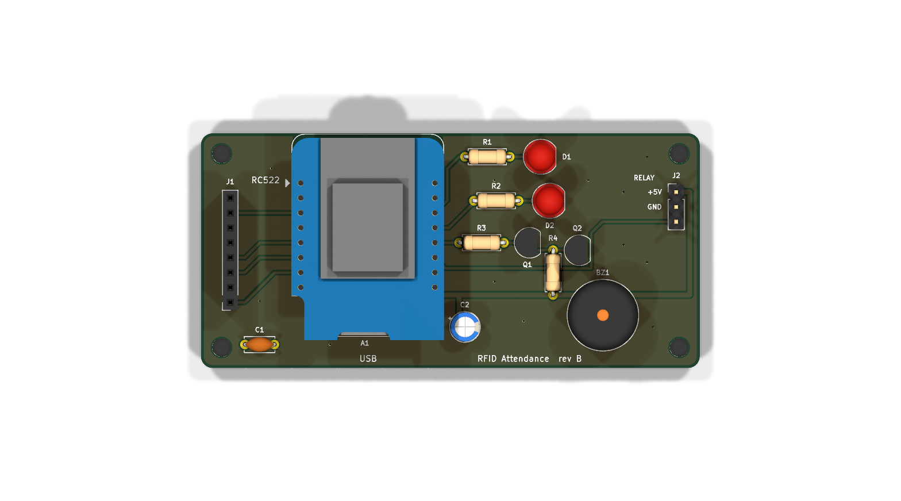
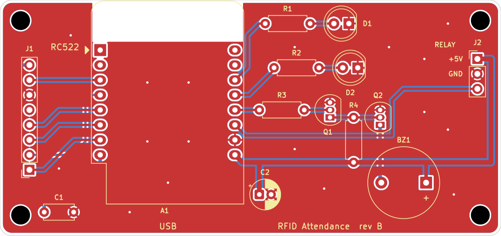
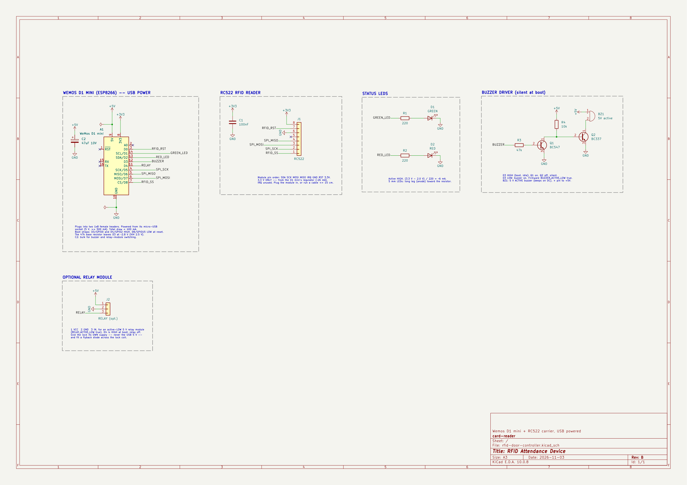

# Carrier board (KiCad 10)

A 2-layer, 85 × 40 mm, all through-hole carrier for the RFID attendance device:
the Wemos D1 mini plugs into two 1×8 female headers, the RC522 into a 1×8
socket on the left edge, and the board adds the two status LEDs, the buzzer
driver and a header for an optional relay module.







| Ref | Part | Notes |
|---|---|---|
| A1 | Wemos D1 mini | Two 1×8 female headers. Antenna at the top edge, USB at the bottom edge |
| J1 | 1×8 female socket, RC522 | SDA SCK MOSI MISO IRQ GND RST 3.3V, pin 1 at the bottom |
| C1 | 100 nF | RC522 3.3 V decoupling |
| C2 | 47 µF 10 V | 5 V bulk for the buzzer and relay module |
| R1, D1 | 220 Ω, green 5 mm LED | D1 pin, active HIGH |
| R2, D2 | 220 Ω, red 5 mm LED | D2 pin, active HIGH |
| R3, Q1, R4, Q2 | 47 k, BC547, 10 k, BC337 | Inverting buzzer driver: silent at boot |
| BZ1 | 5 V active buzzer, 7.6 mm pitch | + to +5V |
| J2 | 1×3 pin header, optional | 1 +5V, 2 GND, 3 IN (D4) for an active-LOW relay module |

**Power** comes only from the D1 mini's micro-USB socket (5 V, ≥ 500 mA). The D1
mini's own regulator feeds the RC522 with 3.3 V. Give a door lock its own supply;
never run it from the USB 5 V.

**Firmware** (`firmware/src/config.h`) for this board:

```c
#define LED_ACTIVE_LOW     false
#define BUZZER_ACTIVE_LOW  true    // inverting driver: D3 LOW = beep, D3 HIGH at boot = silent
#define RELAY_ACTIVE_LOW   true    // active-LOW relay module on J2
```

## Files

| File | What it is |
|---|---|
| `generate_schematic.py` | Writes `rfid-door-controller.kicad_sch` and proves it against the netlist spec in the script |
| `place_board.py` | Creates and places `rfid-door-controller.kicad_pcb` from a coordinate table |
| `route_board.py` | Routes every net, adds GND stitching and pours, runs DRC |
| `schlib.py`, `pcblib.py`, `routelib.py` | The builder libraries the three scripts use |
| `rfid-door-controller-schematic.pdf` | The schematic, printed |
| `fab/` | Gerbers + drill (`fab/rfid-door-controller-gerbers.zip`) and `bom.csv` |
| `render/` | 3D renders, top and bottom |

The `.kicad_sch` and `.kicad_pcb` are generated: change the scripts, not the files,
or your edits are lost on the next run. (The scripts refuse to overwrite a file
that was edited in KiCad since they wrote it, and back it up first.)

## Regenerating

Needs KiCad 10: `kicad-cli` on the PATH for the schematic and KiCad's own Python
(`pcbnew`) for the board.

```bash
python3 generate_schematic.py            # schematic + netlist/ERC check
python3 generate_schematic.py --force    # after porting hand edits into the script
"$KPY" place_board.py --force            # resets every footprint to the table
"$KPY" route_board.py                    # tracks, vias, pours, DRC
```

`$KPY` is KiCad's Python: `/usr/bin/python3` on a distro KiCad, or
`"C:\Program Files\KiCad\10.0\bin\python.exe"` on Windows.

Fab outputs:

```bash
kicad-cli sch export pdf -o rfid-door-controller-schematic.pdf rfid-door-controller.kicad_sch
kicad-cli pcb export gerbers -o fab/gerbers/ rfid-door-controller.kicad_pcb
kicad-cli pcb export drill   -o fab/gerbers/ rfid-door-controller.kicad_pcb
```

## Checks

- Schematic: KiCad's netlist matches the spec in `generate_schematic.py` exactly;
  ERC has 0 errors.
- Board: DRC has 0 errors, 0 unconnected and 0 schematic-parity items. Any
  `lib_footprint_issues` mean that KiCad cannot find its stock footprint libraries
  (for example, a portable install with no library tables). They are not board faults.
- Both GND pours are each one piece, tied together by 17 stitching vias.

## Assembly notes

- Solder the low parts first: resistors, C1, the transistors (flat face as on the
  silkscreen), then the LEDs (long leg toward the resistor), C2 (the + mark),
  the buzzer (+ to the right), the headers, and the sockets last.
- Plug the D1 mini in with its USB socket toward the bottom edge. The antenna end
  sits over the copper-free area at the top edge.
- The RC522 plugs into J1 component side out, or connects through a cable no
  longer than 15 cm.
